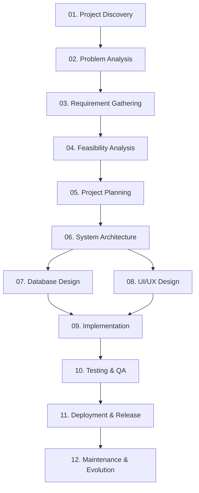

# Section 02: Software Development Lifecycle (SDLC)

> **Tier 1: Universal Engineering Core**  
> **Level 1 AI Instruction Baseline**

---

## Overview

The **Software Development Lifecycle (SDLC)** is the systematic, phased process used to take a software concept from raw idea to reliable production deployment and long-term maintenance. 

Rushing directly from an idea into writing code is the #1 reason projects fail: it leads to building the wrong product, selecting unworkable architectures, encountering late-stage database migration nightmares, and releasing brittle, untested software.

This lifecycle defines **12 clear phases**, establishing deterministic inputs, concrete engineering activities, expected outputs, tangible deliverables, and binary completion criteria (exit gates) for each stage.

---

## SDLC Phase Matrix

---

## Directory Catalog

| Phase | Stage | Primary Objective | Key Deliverable |
| :---: | :--- | :--- | :--- |
| **01** | [01-project-discovery.md](01-project-discovery.md) | Clarify vision, target audience & value proposition | Project Proposal / Pitch |
| **02** | [02-problem-analysis.md](02-problem-analysis.md) | Deconstruct core problem & user pain points | Problem Statement & Impact Brief |
| **03** | [03-requirement-gathering.md](03-requirement-gathering.md) | Define Functional (FR) & Non-Functional (NFR) specs | SRS Document & User Stories |
| **04** | [04-feasibility-analysis.md](04-feasibility-analysis.md) | Evaluate technical, financial & timeline viability | Feasibility & Risk Report |
| **05** | [05-project-planning.md](05-project-planning.md) | Milestone scheduling, task breakdown & work packages | Roadmap & Milestone Plan |
| **06** | [06-system-architecture.md](06-system-architecture.md) | High-level system structure, patterns & module design | Software Architecture Doc (SAD) |
| **07** | [07-database-design.md](07-database-design.md) | Entity relationships, normalization & schema migration | Database Design Doc & ERD |
| **08** | [08-ui-ux-design.md](08-ui-ux-design.md) | User flows, wireframes, component design system | UI/UX Specification & Wireframes |
| **09** | [09-implementation.md](09-implementation.md) | Disciplined coding, unit tests & incremental commits | Working Source Code & PRs |
| **10** | [10-testing.md](10-testing.md) | Risk-based testing, integration tests & bug fixes | Test Execution Report & Bug Fixes |
| **11** | [11-deployment.md](11-deployment.md) | Production build preparation, signing & release | Signed Release Binary & Release Notes |
| **12** | [12-maintenance.md](12-maintenance.md) | Monitoring, bug triage, tech debt & updates | Maintenance Log & Minor Releases |

---

## Agile & Scrum Integration

The 12 SDLC phases are not a rigid waterfall process. In modern engineering, they map directly into **Agile Sprint Cycles**:
* **Sprint 0 / Inception (Phases 01–08)**: High-level discovery, requirements, feasibility, architecture, database schemas, and wireframing.
* **Iterative Feature Sprints (Phases 09–11)**: Continuous 2-week sprint cycles where vertical user stories traverse implementation, risk-based testing, and automated deployment.
* **Continuous Maintenance (Phase 12)**: Ongoing defect triage, security updates, and tech debt reduction managed via a 15–20% sprint capacity buffer.

> [!TIP]
> For detailed ceremony timeboxes, INVEST story criteria, Definition of Ready/Done, and Scrum Master guidance, see the dedicated [Agile Engineering & Scrum Delivery Guide](../docs/guides/AGILE_SCRUM_GUIDE.md).

---

## Standard Phase Schema

Every stage specification in this directory adheres to a mandatory 5-part structure:
1. **Inputs**: Prerequisites and upstream artifacts required to begin.
2. **Activities**: Step-by-step engineering tasks to execute.
3. **Expected Outputs**: Direct technical results produced during execution.
4. **Deliverables**: Formally formatted documents, diagrams, or code assets.
5. **Completion Criteria (Exit Gate)**: A strict binary checklist that must pass before advancing.
