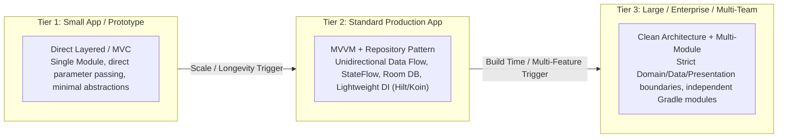

# Section 03: Software Architecture Standards & Complexity Fit Matrix

> **Tier 1: Universal Engineering Core**  
> **Level 1 AI Instruction Baseline**

---

## Overview

Software architecture defines how a system is divided into components, how responsibilities are assigned, and how data and control flow between them. 

The most common trap for an intermediate developer—and for careless AI coding agents—is **premature overengineering**: forcing an enterprise Clean Architecture with 15 interfaces, 4 mapper classes, and 3 Gradle modules onto a simple 3-screen utility app that only needs 300 lines of code.

This section provides actionable architectural guidance, contrasting the trade-offs of major patterns, and establishing an objective **Architecture Fit Matrix** to select the right pattern for the right problem scale.

---

## The Architecture Complexity Fit Matrix

| Project Scale | Recommended Architecture | When It's Overengineering |
| :--- | :--- | :--- |
| **Small / Prototype / Tool** ($< 5$ screens, single developer, rapid validation) | **Layered Architecture or MVC** Direct UI $\rightarrow$ Storage calls, single Gradle module. | Forcing Domain use-cases, repository interfaces, and complex DI frameworks. |
| **Standard Production App** (5–25 screens, production lifecycle, local DB + API) | **MVVM + Repository Pattern** UI (Compose) $\rightarrow$ ViewModel (StateFlow) $\rightarrow$ Repository $\rightarrow$ Data Sources. | Creating separate Domain modules with boilerplate `GetUsersUseCase` that simply forwards calls to `UserRepository.getUsers()`. |
| **Large / Multi-Feature / Enterprise** ($> 25$ screens, multi-team, mission-critical) | **Clean Architecture + Multi-Module** Independent `:feature:*` and `:core:*` modules, strict dependency inversion. | Applying this to personal side projects or small utility apps where Gradle build overhead outweighs modularity benefits. |

---

## Directory Catalog

| File | Pattern / Topic | Best Fit |
| :--- | :--- | :--- |
| [01-layered-architecture.md](file:///c:/Users/datnt249/AndroidStudioProjects/personal-engineering-playbook/03-architecture/01-layered-architecture.md) | Layered Architecture | Small to mid-size apps, standard separation |
| [02-clean-architecture.md](file:///c:/Users/datnt249/AndroidStudioProjects/personal-engineering-playbook/03-architecture/02-clean-architecture.md) | Clean Architecture | Enterprise, long-lived apps with rich domain rules |
| [03-mvc-pattern.md](file:///c:/Users/datnt249/AndroidStudioProjects/personal-engineering-playbook/03-architecture/03-mvc-pattern.md) | MVC Pattern | Small utilities, web controllers, legacy systems |
| [04-mvvm-pattern.md](file:///c:/Users/datnt249/AndroidStudioProjects/personal-engineering-playbook/03-architecture/04-mvvm-pattern.md) | MVVM Pattern | Modern Android (Jetpack Compose + ViewModel) |
| [05-repository-pattern.md](file:///c:/Users/datnt249/AndroidStudioProjects/personal-engineering-playbook/03-architecture/05-repository-pattern.md) | Repository Pattern | Mediating between UI state and multiple data sources |
| [06-dependency-injection.md](file:///c:/Users/datnt249/AndroidStudioProjects/personal-engineering-playbook/03-architecture/06-dependency-injection.md) | Dependency Injection | Decoupling object creation from business usage |
| [07-modular-architecture.md](file:///c:/Users/datnt249/AndroidStudioProjects/personal-engineering-playbook/03-architecture/07-modular-architecture.md) | Modular Architecture | Scaling large applications via Gradle subprojects |
| [08-ui-business-logic-separation.md](file:///c:/Users/datnt249/AndroidStudioProjects/personal-engineering-playbook/03-architecture/08-ui-business-logic-separation.md) | UI & Logic Separation | Keeping Composables pure and logic unit-testable |
| [09-state-management.md](file:///c:/Users/datnt249/AndroidStudioProjects/personal-engineering-playbook/03-architecture/09-state-management.md) | State Management & UDF | Unidirectional Data Flow, immutable UI state |
| [10-api-communication.md](file:///c:/Users/datnt249/AndroidStudioProjects/personal-engineering-playbook/03-architecture/10-api-communication.md) | API Communication | Robust REST client patterns, error serialization |
| [11-database-integration.md](file:///c:/Users/datnt249/AndroidStudioProjects/personal-engineering-playbook/03-architecture/11-database-integration.md) | Database Integration | Safe offline-first persistence, Room, reactive queries |
