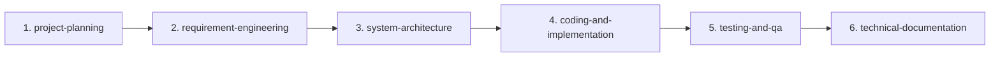
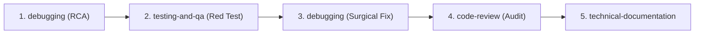
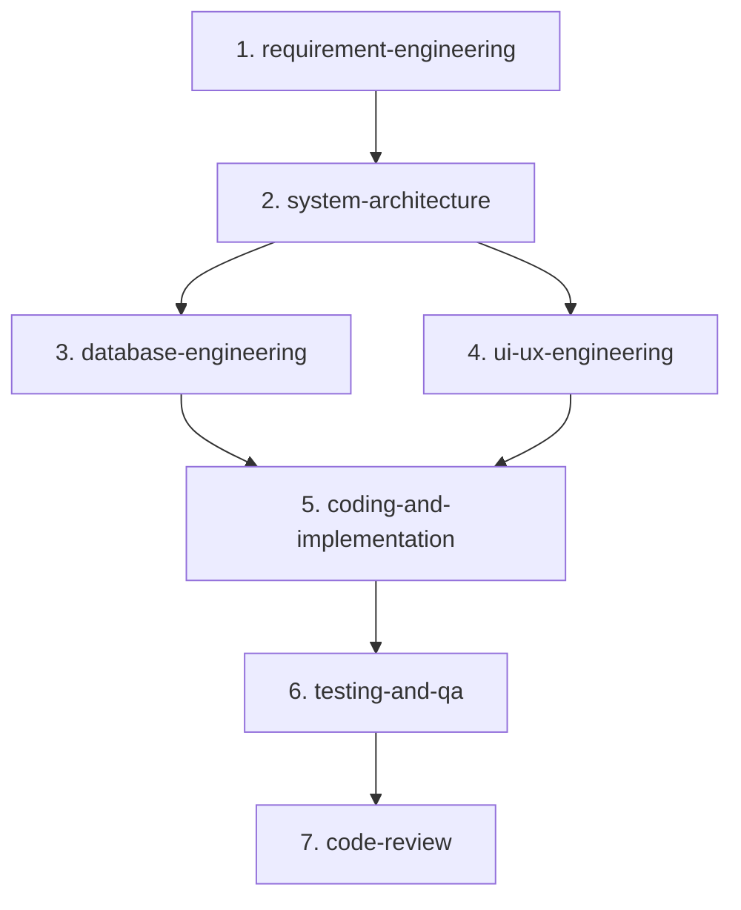

# Integration Scenario Walkthroughs & Skill Coordination Audit

> **Tier 1: Universal Engineering Core**  
> **Section 05: Reusable AI Agent Skills**  
> **Acceptance Criterion**: M3-06 (Multi-Skill Lifecycle Integration)

---

## 1. Overview
This document evaluates the practical interoperability and behavioral coordination of the 12 reusable skills across three real-world software engineering scenarios:
1. **Scenario A: Building a Simple Application** (Rapid, lean lifecycle without premature complexity).
2. **Scenario B: Triage & Resolution of a Critical Production Bug** (Evidence-based root cause analysis and regression testing).
3. **Scenario C: Adding a Complex Feature** (Multi-skill coordination across database, UI, and security).

---

## 2. Scenario A: Building a Simple Application (Flashcard Learning App)

### Objective
Verify that an AI coding agent transitions cleanly through the delivery lifecycle (Planning $\rightarrow$ Requirements $\rightarrow$ Architecture $\rightarrow$ Coding $\rightarrow$ Testing $\rightarrow$ Documentation) without introducing premature enterprise abstractions.

### Execution Trace & Skill Chain

| Lifecycle Step | Skill Invoked | Agent Action & Deliverable | Complexity Guard / Invariant Enforced |
| :--- | :--- | :--- | :--- |
| **1. Planning** | `project-planning` | Produced WBS for MVP: local card storage, review screen, flip animation. Scoped cloud sync to "Won't-Have". | Guarded against multi-sprint planning; scoped for $< 3$ screens. |
| **2. Requirements** | `requirement-engineering` | Authored 3 User Stories with Gherkin acceptance scenarios for card flip and answer recording. | Focused on functional acceptance without specifying premature libraries. |
| **3. Architecture** | `system-architecture` | Evaluated against **Complexity Fit Matrix**: Selected **Tier 1 / Tier 2 Lean MVVM** (Single module, local storage, ViewModel + StateFlow). | **Anti-Overengineering Check**: Explicitly rejected multi-module Gradle and Domain Use Cases. |
| **4. Implementation** | `coding-and-implementation` | Implemented vertical slice: storage $\rightarrow$ ViewModel $\rightarrow$ Compose UI with pure state hoisting. | Variables declared `val`; pure UI with zero database access in Composables. |
| **5. Testing** | `testing-and-qa` | Wrote unit tests for `FlashcardViewModel` card rotation and score calculations using virtual time. | Applied Risk-Based Testing: 0 unit tests on declarative layout; 100% on domain score math. |
| **6. Documentation** | `technical-documentation` | Updated `README.md` with setup instructions and added ADR for storage choice. | Synchronized docs with actual code. |

**Scenario A Verdict**: **PASS**. The agent progressed through the delivery pipeline smoothly, producing clean, working software without unnecessary enterprise boilerplate.

---

## 3. Scenario B: Triage & Resolution of a Production Crash (Race Condition)

### Objective
Verify that an AI coding agent diagnoses a root cause, writes a failing regression test before fixing the code, applies a minimal surgical fix, and avoids collateral regressions (`debugging` $\rightarrow$ `testing-and-qa` $\rightarrow$ `code-review` $\rightarrow$ `technical-documentation`).

### Execution Trace & Skill Chain

| Step | Skill Invoked | Agent Action & Deliverable | Invariant Enforced |
| :--- | :--- | :--- | :--- |
| **1. Triage & RCA** | `debugging` | Inspected logcat stack trace: `NullPointerException` thrown in `CartViewModel` when user rapidly double-taps "Checkout". Identified race condition in un-conflated coroutine. | **No Shotgun Fixes**: Refused to simply slap `?.` or empty try/catch. |
| **2. Red Test** | `testing-and-qa` | Wrote `CheckoutViewModelTest` firing two simultaneous checkout events. Executed test: **FAILED** with expected NPE. | **Mandatory Reproduction**: Proved bug exists before altering production code. |
| **3. Surgical Fix** | `debugging` | Replaced un-throttled coroutine with `AtomicBoolean` guard and mutex in ViewModel. Reran test: **PASSED**. | Minimal, localized fix with zero touch on unrelated classes. |
| **4. Code Review** | `code-review` | Audited diff: Verified zero regressions, confirmed memory safety, categorized comment as `[SUGGESTION]` to use Kotlin Mutex. | Independent quality gate. |
| **5. Documentation** | `technical-documentation` | Documented RCA in `11-bug-report.md` and added entry to `CHANGELOG.md` under `[Fixed]`. | Permanent knowledge capture. |

**Scenario B Verdict**: **PASS**. The agent followed the strict Red $\rightarrow$ Green test-driven regression workflow, proving the bug fix empirically.

---

## 4. Scenario C: Adding a Complex Feature (Biometric Vault & Export)

### Objective
Verify multi-skill coordination across cross-cutting disciplines: `requirement-engineering` $\rightarrow$ `system-architecture` $\rightarrow$ `database-engineering` $\rightarrow$ `ui-ux-engineering` $\rightarrow$ `coding-and-implementation` $\rightarrow$ `testing-and-qa` $\rightarrow$ `code-review`.

### Execution Trace & Skill Chain

| Step | Skill Invoked | Deliverables & Coordination Actions |
| :--- | :--- | :--- |
| **1. Requirements** | `requirement-engineering` | Specified `FR-VAULT-001` (Encrypted biometric export) with NFRs for AES-256 GCM encryption. |
| **2. Architecture** | `system-architecture` | Authored TDR-004: Selected Android Keystore for key generation + SQLCipher for database encryption at rest. |
| **3. Database** | `database-engineering` | Formulated 3NF encrypted schema with parameterized DAO queries and automated migration from unencrypted v1 to encrypted v2. |
| **4. UI/UX** | `ui-ux-engineering` | Designed 4 UI states (Biometric Prompt, Decrypting Shimmer, Vault Content, Auth Failed Error) with $\ge 48$dp touch targets. |
| **5. Implementation** | `coding-and-implementation` | Implemented vertical slice: Keystore provider $\rightarrow$ Room DB with SQLCipher open helper $\rightarrow$ BiometricViewModel $\rightarrow$ Compose screen. |
| **6. Testing** | `testing-and-qa` | Verified migration test preserving existing notes and unit tests verifying biometric cancellation state. |
| **7. Code Review** | `code-review` | Audited for security: verified zero hardcoded passphrases, confirmed TLS for external exports, checked PII stripping in logs. Sign-off granted. |

**Scenario C Verdict**: **PASS**. Multiple skills collaborated seamlessly, respecting database, UI, security, and testing invariants without conflicting instructions.
