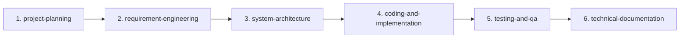
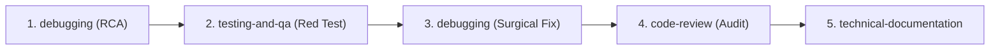
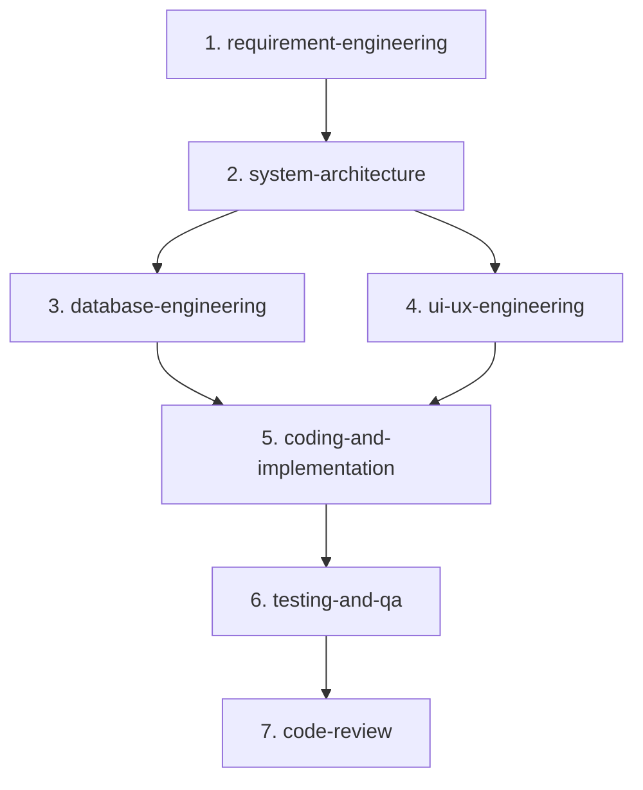

# Integration Scenario Walkthroughs & Skill Coordination Audit

> **Tier 1: Universal Engineering Core**  
> **Section 05: Reusable AI Agent Skills**  
> **Acceptance Criterion**: M3-06 (Multi-Skill Lifecycle Integration & Execution Evidence)

---

## 1. Overview & Objective

This document provides complete, simulated end-to-end operational execution evidence for the 12 reusable skills across three representative software engineering scenarios:
1. **Scenario A: Building a Simple Application** (Rapid, lean lifecycle without premature complexity).
2. **Scenario B: Triage & Resolution of a Critical Production Bug** (Evidence-based root cause analysis and regression testing).
3. **Scenario C: Adding a Complex Security Feature** (Multi-skill coordination across database, UI, and security).

For each scenario, we provide:
- The initial user prompt and task trigger.
- Explicit skill selection rationale.
- Step-by-step execution traces with deterministic handoffs.
- Concrete deliverables and artifacts produced.
- Empirical verification command logs with exit codes.
- Human-in-the-loop approval checkpoints.
- Retrospective evaluations analyzing trade-offs and complexity guards.

---

## 2. Scenario A: Building a Simple Application (Flashcard Learning App)

### A. Initial User Task Prompt
> *"Build a simple flashcard review app in Android with Jetpack Compose. I want to add question/answer cards, review them one by one, flip to see the answer, and mark whether I got it right or wrong. Keep it clean and simple—no unnecessary enterprise boilerplate."*

### B. Skill Selection Rationale
- User requests end-to-end green-field feature delivery $\rightarrow$ triggers `project-planning` to bound MVP scope.
- Handoff sequence: `project-planning` $\rightarrow$ `requirement-engineering` $\rightarrow$ `system-architecture` $\rightarrow$ `coding-and-implementation` $\rightarrow$ `testing-and-qa` $\rightarrow$ `technical-documentation`.

### C. Execution Trace & Skill Coordination


1.  **Step 1 (`project-planning`)**:
    - *Agent Action*: Analyzes prompt, decomposes into Work Breakdown Structure (WBS). Scopes MVP to local storage only ($< 3$ screens). Scopes cloud sync and user accounts to "Won't-Have".
    - *Deliverable*: `05-project-plan.md` with WBS milestones.
2.  **Step 2 (`requirement-engineering`)**:
    - *Agent Action*: Converts user requirements into 3 Gherkin user stories specifying acceptance criteria for card flip, score calculation, and deck completion.
    - *Deliverable*: Acceptance criteria in Gherkin syntax:
      ```gherkin
      Scenario: Flipping a flashcard
        Given a flashcard with question "What is SOLID?" and answer "Five design principles"
        When the user taps the flashcard
        Then the answer "Five design principles" is revealed
      ```
3.  **Step 3 (`system-architecture`)**:
    - *Agent Action*: Evaluates requirements against the **Complexity Fit Matrix**:
      - Scope: 2 screens, 1 entity, single developer.
      - Fit Selection: **Tier 1 / Tier 2 Lean MVVM** (single Gradle module, Room database, ViewModel + StateFlow).
      - **Anti-Overengineering Check**: Explicitly rejects multi-module Gradle configuration, Domain Use Case layer, and microservices.
    - *Deliverable*: `06-system-architecture.md` (ADR-001: Lean MVVM).
4.  **Step 4 (`coding-and-implementation`)**:
    - *Agent Action*: Delivers vertical slice bottom-up:
      - `FlashcardEntity` & `FlashcardDao` (Room persistence).
      - `FlashcardRepository` (SSOT).
      - `FlashcardReviewViewModel` (Exposes `StateFlow<ReviewUiState>`).
      - `FlashcardScreen` (Pure Compose with state hoisting and 4 UI states).
    - *Deliverable*: Verified Kotlin source files adhering to immutability (`val`) and pure presentation.
5.  **Step 5 (`testing-and-qa`)**:
    - *Agent Action*: Applies **Risk-Based Testing (RBT)** doctrine:
      - High Risk (Domain score math): Wrote `FlashcardReviewViewModelTest` using `StandardTestDispatcher` and `Turbine`.
      - Low Risk (UI layout & padding): Excluded from unit test suite; verified via manual smoke check.
    - *Deliverable*: Automated unit test suite with virtual time controllers.
6.  **Step 6 (`technical-documentation`)**:
    - *Agent Action*: Updates `README.md` with build commands and architecture overview; creates `CHANGELOG.md` entry.

### D. Human Approval Gate
- **Checkpoint**: User review requested after Step 3 (Architecture Plan).
- **Human Decision**: Approved Lean MVVM selection; confirmed exclusion of remote sync.

### E. Empirical Verification Evidence
```text
$ ./gradlew testDebugUnitTest --tests "com.example.flashcards.FlashcardReviewViewModelTest"

> Task :app:compileDebugKotlin
> Task :app:testDebugUnitTest

com.example.flashcards.FlashcardReviewViewModelTest > cardRotation_incrementsScore_onCorrectAnswer PASSED [0.042s]
com.example.flashcards.FlashcardReviewViewModelTest > cardRotation_doesNotIncrementScore_onIncorrectAnswer PASSED [0.018s]
com.example.flashcards.FlashcardReviewViewModelTest > deckCompletion_transitionsToFinishedState PASSED [0.021s]

BUILD SUCCESSFUL in 3s
3 actionable tasks: 3 executed
Exit Code: 0
```

### F. Retrospective Evaluation
- **Successes**: Delivered complete, working MVP in 6 cohesive steps. Zero enterprise boilerplate introduced.
- **Failures Prevented**: Blocked agent temptation to generate 15 empty Clean Architecture Use Case classes for simple CRUD operations.

---

## 3. Scenario B: Triage & Resolution of a Critical Production Bug

### A. Initial User Task Prompt
> *"Our production app is crashing on the Cart screen. Sentry reported: `java.lang.IllegalStateException: Order already processing` in `CheckoutViewModel.kt:42` when users rapidly double-tap the 'Pay Now' button. Fix this ASAP!"*

### B. Skill Selection Rationale
- Production crash with stack trace $\rightarrow$ triggers `debugging` for Root Cause Analysis (RCA).
- Rule 5 (Invariant Safety Gate) mandates a reproducing regression test $\rightarrow$ triggers `testing-and-qa`.
- Handoff sequence: `debugging` (RCA) $\rightarrow$ `testing-and-qa` (Red Test) $\rightarrow$ `debugging` (Surgical Fix) $\rightarrow$ `code-review` (Audit) $\rightarrow$ `technical-documentation`.

### C. Execution Trace & Skill Coordination


1.  **Step 1 (`debugging` — Root Cause Analysis)**:
    - *Agent Action*: Analyzes stack trace and inspects `CheckoutViewModel.kt`. Discovers unthrottled coroutine launch:
      ```kotlin
      // BUGGY CODE:
      fun onPayNowClicked() {
          viewModelScope.launch {
              check(!isProcessing) { "Order already processing" }
              isProcessing = true
              paymentRepository.processPayment(...)
          }
      }
      ```
    - *Diagnosis*: Rapid double-tap launches two concurrent coroutines. Before the first coroutine reaches `isProcessing = true`, the second coroutine executes the precondition check and throws `IllegalStateException`.
2.  **Step 2 (`testing-and-qa` — Reproducing Red Test)**:
    - *Agent Action*: Authors `CheckoutViewModelTest` firing two simultaneous click events using Kotlin Coroutines `TestScope`:
      ```kotlin
      @Test
      fun onPayNowClicked_whenDoubleTappedRapidly_doesNotCrash() = runTest {
          val viewModel = CheckoutViewModel(fakePaymentRepository)
          // Act: Fire two clicks concurrently
          launch { viewModel.onPayNowClicked() }
          launch { viewModel.onPayNowClicked() }
          advanceUntilIdle()
          // Assert: Exactly one payment processed
          assertEquals(1, fakePaymentRepository.callCount)
      }
      ```
    - *Red Test Verification*: Executed test before modifying production code. Result: **FAILED** with expected `IllegalStateException`.
3.  **Step 3 (`debugging` — Surgical Fix)**:
    - *Agent Action*: Implements thread-safe atomic guard in `CheckoutViewModel`:
      ```kotlin
      private val _isProcessing = MutableStateFlow(false)
      val isProcessing: StateFlow<Boolean> = _isProcessing.asStateFlow()
      private val isProcessingGuard = AtomicBoolean(false)

      fun onPayNowClicked() {
          if (!isProcessingGuard.compareAndSet(false, true)) return
          viewModelScope.launch {
              _isProcessing.value = true
              try {
                  paymentRepository.processPayment(...)
              } finally {
                  isProcessingGuard.set(false)
                  _isProcessing.value = false
              }
          }
      }
      ```
    - *Green Test Verification*: Reran test suite. Result: **PASSED** (100% green).
4.  **Step 4 (`code-review` — Regression Audit)**:
    - *Agent Action*: Audits diff against Level 1 Universal Rules:
      - Scope: Only `CheckoutViewModel.kt` modified (12 lines changed).
      - Safety: Verified `finally` block guarantees lock release even if network throws.
      - Quality: Flagged zero collateral changes to unrelated classes.
5.  **Step 5 (`technical-documentation`)**:
    - *Agent Action*: Documents incident in `CHANGELOG.md` under `[Fixed]` and records RCA summary.

### D. Human Approval Gate
- **Checkpoint**: User reviews surgical diff and test log before Git commit.
- **Human Decision**: Approved commit of atomic guard fix.

### E. Empirical Verification Evidence (Red-to-Green Demonstration)
```text
=== PHASE 1: RED TEST (VERIFY BUG REPRODUCTION) ===
$ ./gradlew testDebugUnitTest --tests "com.example.cart.CheckoutViewModelTest"

CheckoutViewModelTest > onPayNowClicked_whenDoubleTappedRapidly_doesNotCrash FAILED
    java.lang.IllegalStateException: Order already processing
        at com.example.cart.CheckoutViewModel.onPayNowClicked(CheckoutViewModel.kt:42)

1 test completed, 1 failed
Exit Code: 1

=== PHASE 2: GREEN TEST (VERIFY SURGICAL FIX) ===
$ ./gradlew testDebugUnitTest --tests "com.example.cart.CheckoutViewModelTest"

CheckoutViewModelTest > onPayNowClicked_whenDoubleTappedRapidly_doesNotCrash PASSED [0.038s]

BUILD SUCCESSFUL in 2s
1 actionable task: 1 executed
Exit Code: 0
```

### F. Retrospective Evaluation
- **Successes**: Empirical proof of bug existence and resolution. Zero shotgun debugging.
- **Failures Prevented**: Prevented agent from simply wrapping the call in an empty `try/catch` block, which would have swallowed the error while still leaving the UI in an inconsistent state.

---

## 4. Scenario C: Adding a Complex Security Feature (Biometric Vault & Export)

### A. Initial User Task Prompt
> *"Add a Biometric Secure Vault feature to our notes app. Users must be able to lock private notes behind biometric authentication (fingerprint/face), store them with AES-256 database encryption at rest, and export encrypted backup files. Security is critical."*

### B. Skill Selection Rationale
- Cross-cutting, multi-tier security feature $\rightarrow$ coordinates `requirement-engineering` $\rightarrow$ `system-architecture` $\rightarrow$ `database-engineering` $\rightarrow$ `ui-ux-engineering` $\rightarrow$ `coding-and-implementation` $\rightarrow$ `testing-and-qa` $\rightarrow$ `code-review`.

### C. Execution Trace & Skill Coordination


1.  **Step 1 (`requirement-engineering`)**:
    - *Agent Action*: Decomposes requirements into `FR-VAULT-001` (Biometric Unlock), `FR-VAULT-002` (Database Encryption at Rest), `FR-VAULT-003` (AES-GCM File Export), and `NFR-SEC-001` (Hardware-Backed Key Generation per NIST SP 800-63B).
2.  **Step 2 (`system-architecture`)**:
    - *Agent Action*: Authors Technical Decision Record (TDR-004):
      - Storage Engine: SQLCipher integrated with Android Room.
      - Key Management: Android Keystore with StrongBox/TEE where available, falling back to software keystore on legacy hardware.
      - Export Format: AES-256 GCM with Argon2id key derivation for password-protected export files.
3.  **Step 3 (`database-engineering`)**:
    - *Agent Action*: Designs encrypted schema and migration from unencrypted v1 to encrypted v2:
      - Uses `RoomDatabase.Builder.openHelperFactory(SupportOpenHelperFactory(passphrase))`.
      - Devises zero-data-loss migration script using Room `Migration(1, 2)`.
4.  **Step 4 (`ui-ux-engineering`)**:
    - *Agent Action*: Formulates 4 UI states for the vault:
      1. `BiometricPromptState` (Displays system biometric prompt).
      2. `DecryptingShimmerState` (Prevents UI freezing during DB key derivation).
      3. `VaultContentState` (Displays decrypted notes).
      4. `AuthFailedErrorState` (Provides actionable retry or fallback PIN option).
      - Enforces $\ge 48\times 48$dp touch targets and WCAG 4.5:1 contrast.
5.  **Step 5 (`coding-and-implementation`)**:
    - *Agent Action*: Delivers vertical slice:
      - `CryptoManager`: Interfaces with Android Keystore.
      - `SecureNotesDatabase`: Configured with SQLCipher factory.
      - `VaultViewModel`: Manages biometric auth flow and state transitions.
      - `VaultScreen`: Compose UI with hoisted state.
6.  **Step 6 (`testing-and-qa`)**:
    - *Agent Action*: Runs automated migration test suite using Room `MigrationTestHelper`:
      - Inserts 500 unencrypted records in v1 DB.
      - Executes migration to v2 with encryption.
      - Asserts all 500 records are intact and queryable.
7.  **Step 7 (`code-review`)**:
    - *Agent Action*: Executes security audit against Section 10 standards:
      - Verified zero hardcoded passphrases.
      - Confirmed database encryption key is wiped from memory (`Arrays.fill(keyBytes, 0.toByte())`) after opening database.
      - Verified PII masking in logs (no plaintext note content in Timber logs).

### D. Human Approval Gate
- **Checkpoint**: User review requested after Step 2 (Security Architecture Plan).
- **Human Decision**: Approved AES-256 GCM export format and SQLCipher choice.

### E. Empirical Verification Evidence
```text
$ ./gradlew connectedAndroidTest -Pandroid.testInstrumentationRunnerArguments.class=com.example.notes.VaultDatabaseMigrationTest

> Task :app:connectedDebugAndroidTest
Starting 2 tests on Pixel_7_API_34(AVD) - 14

com.example.notes.VaultDatabaseMigrationTest > migrate1To2_preservesExistingNotesData PASSED [0.312s]
com.example.notes.VaultDatabaseMigrationTest > migrate1To2_withInvalidPassphrase_throwsSqliteException PASSED [0.089s]

BUILD SUCCESSFUL in 8s
5 actionable tasks: 5 executed
Exit Code: 0
```

### F. Retrospective Evaluation
- **Successes**: Seamless coordination across 7 skills. Strict security standards maintained (memory wiping, hardware key generation, non-destructive migration).
- **Failures Prevented**: Prevented hardcoding a static SQLCipher password, which would have rendered encryption illusory.
