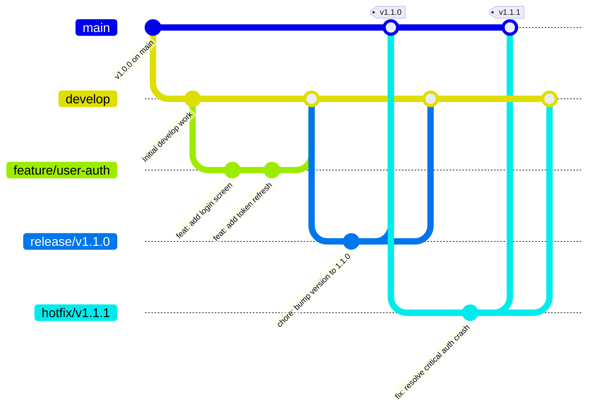

# Git and Version Control Skill

## 1. Overview & Capability
The **Git and Version Control Skill** guides the disciplined management of source code repositories. It provides concrete operational standards for both **Trunk-Based Development** (for fast-paced continuous delivery) and the **Gitflow Workflow** (referenced from the [Atlassian Gitflow Workflow](https://www.atlassian.com/git/tutorials/comparing-workflows/gitflow-workflow) standard for scheduled, mobile, and multi-version releases). 

It enforces **Conventional Commits**, **Atomic Commits**, and **Semantic Version Tagging**, ensuring that Git history remains a clean, bisectable audit trail of project evolution.

---

## 2. When to Use & When NOT to Use

### When to Use
*   Authoring and staging atomic Git commits for features, bug fixes, or chores.
*   Selecting and executing the appropriate branching model (Gitflow vs. Trunk-Based).
*   Creating and merging `feature/*`, `release/*`, or `hotfix/*` branches.
*   Authoring Conventional Commit messages (`feat:`, `fix:`, `refactor:`, `chore:`).
*   Tagging production releases (`v1.0.0`) in version control.

### When NOT to Use
*   Implementing application logic or business rules (use `coding-and-implementation`).
*   Running automated test suites (use `testing-and-qa`).
*   Configuring CI/CD runners or container pipelines (use `deployment-and-release`).

---

## 3. Required Inputs & Prerequisites
*   Clean Git working tree (`git status`).
*   Completed, tested, and verified code modifications.
*   Issue, task, or user story reference from `PROJECT_PROGRESS.md` or task tracker.
*   Knowledge of the project's release model (Continuous Delivery vs. Scheduled Releases).

---

## 4. Step-by-Step Deterministic Workflow

```
1. Inspect Status & Diff ──> 2. Stage Atomic Changes ──> 3. Author Conventional Commit ──> 4. Branch Management ──> 5. Release & Tagging
```

### Step 1: Inspect Status & Review Diff
1.  Run `git status` to verify modified, added, or untracked files.
2.  Run `git diff` to review exact changes line-by-line.
3.  Ensure no temporary files, build outputs (`build/`, `dist/`), or secrets (`.env`, `*.pem`, `local.properties`) are staged.

### Step 2: Stage Atomic Changes
An **Atomic Commit** represents a single, complete logical change that leaves the repository compilable with passing tests:
*   Do not combine a new feature and an unrelated code reformat in one commit.
*   Stage specific files explicitly: `git add src/path/File.kt src/test/FileTest.kt`.

### Step 3: Author Conventional Commit Message
Follow the **Conventional Commits 1.0.0** specification:
$$\text{<type>}(\text{<optional scope>}): \text{<concise description>}$$

*   **`feat`**: A new feature for the user.
*   **`fix`**: A bug fix.
*   **`refactor`**: Code restructuring without altering behavior or fixing bugs.
*   **`test`**: Adding, updating, or fixing tests.
*   **`docs`**: Documentation updates only.
*   **`chore`**: Maintenance, build configuration, or dependency updates.

```text
feat(auth): implement token refresh interceptor in OkHttpClient

Automatically requests a fresh access token when encountering HTTP 401 
using stored refresh token in EncryptedSharedPreferences.
Closes #104.
```

---

### Step 4: Branching Models & Workflow Selection

The playbook supports two industry-standard branching models based on project release cadence:

```
+---------------------------------------------------------------------------------------------------------+
|                                    BRANCHING MODEL DECISION MATRIX                                      |
|                                                                                                         |
|  Project Characteristic                          Recommended Model      Rationale                       |
|  ----------------------------------------------  ---------------------  ------------------------------  |
|  Mobile Apps (Android/iOS) with Store Reviews    Gitflow Workflow       Requires stabilization window   |
|  Enterprise with Scheduled Periodic Releases     Gitflow Workflow       Clean cut for QA & release prep |
|  Multiple Maintained Production Versions (LTS)   Gitflow Workflow       Isolated hotfix backporting     |
|  Web Apps / Microservices with CI/CD to Prod     Trunk-Based Dev        Fast cycle, feature toggles     |
|  Single-Developer Learning / Utility Projects    Trunk-Based Dev        Minimal overhead, fast velocity |
+---------------------------------------------------------------------------------------------------------+
```

#### Workflow A: The Gitflow Workflow (Atlassian Reference Standard)
Referenced from [Atlassian Gitflow Workflow](https://www.atlassian.com/git/tutorials/comparing-workflows/gitflow-workflow). Gitflow defines two permanent branches with infinite lifetimes and three dedicated supporting branch types:



1. **Permanent Branches**:
   * **`main`**: Stores official, production-ready release history. Every commit on `main` is tagged with a release version (e.g. `v1.0.0`). Developers never commit directly to `main`.
   * **`develop`**: Serves as the continuous integration branch for features. Contains the latest delivered development changes destined for the next release.
2. **Supporting Branches**:
   * **Feature Branches (`feature/<name>`)**:
     * *Source*: `develop` | *Destination*: `develop`
     * *Commands*:
       ```bash
       # Start feature
       git checkout develop
       git pull origin develop
       git checkout -b feature/biometric-login
       
       # Finish feature (via PR or merge)
       git checkout develop
       git merge --no-ff feature/biometric-login
       git branch -d feature/biometric-login
       ```
   * **Release Branches (`release/<version>`)**:
     * *Source*: `develop` | *Destination*: `main` **and** `develop`
     * *Purpose*: Once `develop` has acquired all features for an upcoming release, branch a release branch. No new features are added here—only bug fixes, documentation, version bumps, and release testing.
     * *Commands*:
       ```bash
       # Start release
       git checkout develop
       git checkout -b release/v1.2.0
       # (Perform version bump, changelog update, release smoke checks)
       git commit -am "chore(release): bump version to 1.2.0"
       
       # Finish release: Merge into main, tag, and back-merge to develop
       git checkout main
       git merge --no-ff release/v1.2.0
       git tag -a v1.2.0 -m "Release v1.2.0 - Biometric Authentication"
       
       git checkout develop
       git merge --no-ff release/v1.2.0
       git branch -d release/v1.2.0
       ```
   * **Hotfix Branches (`hotfix/<version>`)**:
     * *Source*: `main` | *Destination*: `main` **and** `develop`
     * *Purpose*: Urgent maintenance fixes for critical production bugs that cannot wait for the next scheduled release.
     * *Commands*:
       ```bash
       # Start hotfix directly from production tag
       git checkout main
       git checkout -b hotfix/v1.2.1
       # (Fix defect and add regression test)
       git commit -am "fix(security): resolve token replay race condition"
       
       # Finish hotfix: Merge to main, tag, and back-merge to develop
       git checkout main
       git merge --no-ff hotfix/v1.2.1
       git tag -a v1.2.1 -m "Hotfix v1.2.1 - Critical security patch"
       
       git checkout develop
       git merge --no-ff hotfix/v1.2.1
       git branch -d hotfix/v1.2.1
       ```

---

#### Workflow B: Trunk-Based Development
For fast-moving web applications and microservices using continuous deployment:
1. Branch directly from `main`: `git checkout -b feat/add-task-filter main`.
2. Keep branch lifespans short ($\le 1\text{–}2$ days).
3. Merge back to `main` via Pull Request after CI passes.
4. Tag releases directly on `main` or deploy continuously.

---

### Step 5: Release Tagging & SemVer
Every production release must have an annotated, cryptographically clear Git tag:
```bash
git tag -a v1.2.0 -m "Release v1.2.0: Biometric authentication and performance tuning"
git push origin v1.2.0
```

---

## 5. Expected Outputs & Artifact Formats
*   Clean, bisectable Git commit history with Conventional Commit messages.
*   Branch naming following standard prefixes (`feature/*`, `release/*`, `hotfix/*`).
*   Annotated Git tags matching Semantic Versioning (`vMAJOR.MINOR.PATCH`).
*   Descriptive Pull Request descriptions with context and verification proof.

---

## 6. Quality & Verification Checklist
- [ ] Does `git status` confirm that zero secrets, local configs, or build artifacts are staged?
- [ ] Does every commit message adhere to the Conventional Commits specification?
- [ ] Is each commit atomic (independently compilable with passing tests)?
- [ ] If using Gitflow: are release branches merged into **both** `main` and `develop`?
- [ ] If using Gitflow: do hotfix branches branch directly from `main`?
- [ ] Are production releases marked with annotated Git tags (`git tag -a`)?

---

## 7. Common Mistakes & Pitfalls
*   **Merging Release to `main` Only**: In Gitflow, forgetting to merge the release branch back into `develop` leaves `develop` without release bug fixes and version bumps, causing divergent history.
*   **Long-Lived Feature Branches**: Keeping a feature branch open for weeks, resulting in painful merge conflicts ("merge hell").
*   **The "WIP" / "Fix stuff" Commit**: Writing meaningless commit messages that provide zero context during `git bisect` debugging.
*   **Accidental Secret Commits**: Committing keystores, `.env`, or tokens because `.gitignore` was not configured upfront.

---

## 8. Real-World Example Walkthrough
**Scenario**: Delivering a scheduled mobile release `v1.2.0` using Gitflow.
1.  *Branch Release*:
    ```bash
    git checkout develop
    git pull origin develop
    git checkout -b release/v1.2.0
    ```
2.  *Update Metadata*: Update `VERSION.md` to `1.2.0` and record release highlights in `CHANGELOG.md`.
    ```bash
    git commit -am "chore(release): prepare v1.2.0 release metadata"
    ```
3.  *Verify*: Run clean-clone verification and automated test suites:
    ```powershell
    powershell -File .\tools\test-clean-clone.ps1
    ```
4.  *Finish Release*:
    ```bash
    git checkout main
    git merge --no-ff release/v1.2.0
    git tag -a v1.2.0 -m "Release v1.2.0"
    
    git checkout develop
    git merge --no-ff release/v1.2.0
    git branch -d release/v1.2.0
    ```

---

## 9. Related Skills & Hand-Offs
*   $\rightarrow$ Preceded by `coding-and-implementation` or `debugging`.
*   $\rightarrow$ Followed by `deployment-and-release` for artifact packaging and CI deployment.
*   $\rightarrow$ Interacts with `code-review` for pull request quality gates.

---

## 10. Tool Compatibility & Limitations
*   All Git operations can be executed via terminal commands across Linux, macOS, and Windows.
*   AI agents `MUST NEVER` run destructive commands (`git reset --hard`, `git push --force`, `git clean -fd`) without explicit human authorization.
