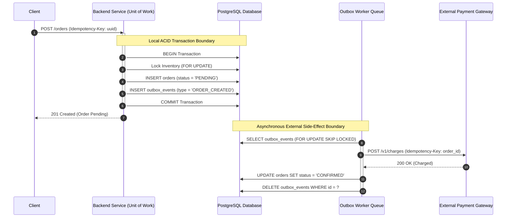
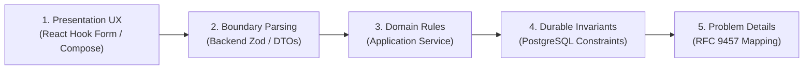
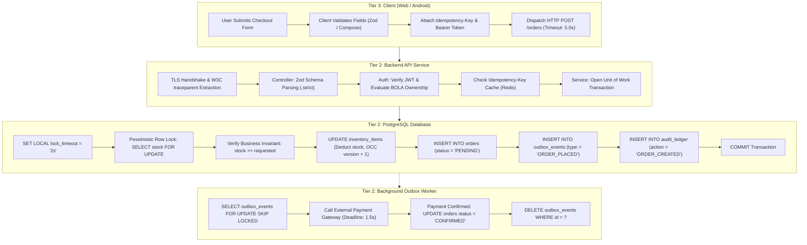

# Tier 2 Cross-Domain Consistency & Integration Standards

> **Level 2 Technology Standard — Cross-Domain Integration Layer**  
> **Applicability**: Mandatory for all full-stack and multi-tier features spanning Web/Android clients, Backend APIs, relational databases, and background asynchronous workers. Adheres to [Universal Core Standards](../01-principles/README.md) and [AGENTS.md](../AGENTS.md).

---

## 1. Architectural Framework & Authoritative Ownership Matrix (Requirement A)

When building distributed systems across multiple technology tiers (Web, Mobile, Backend, Database), identical concerns—such as validation, authorization, transactions, and state management—are evaluated at multiple layers. 

To eliminate ambiguous responsibility, duplicate validation bugs, and security vulnerabilities, the playbook establishes the **Principle of Single Authoritative Ownership**: for every system concern, exactly one layer owns the immutable, authoritative decision. All other layers act as convenient UX accelerators or secondary consumers.

| Architectural Concern | Authoritative Decision Owner | Secondary / Downstream Consumers | Cross-Tier Enforcement Contract |
| :--- | :--- | :--- | :--- |
| **Data Integrity Constraints** | **Relational Database** | Backend Services, Client Forms | Database enforces durable check constraints, unique indexes, and foreign keys. Client/Backend validation prevents bad requests from reaching disk, but the database is the final, unbypassable gate. |
| **Request Schema Validation** | **Backend API Boundary** | Web & Android Clients | Backend parses incoming JSON against strict schemas (Zod, Go Validator) and fails fast with HTTP 400/422. Client validation exists solely for user feedback and UX fluidity. |
| **Business Transaction Boundaries** | **Backend Application Service** | Database (Local ACID), Workers | Application Service orchestrates the **Unit of Work**. It starts, commits, or rolls back local database transactions and queues asynchronous side effects via the Transactional Outbox. |
| **Object-Level Authorization (BOLA/IDOR)** | **Backend Domain Logic** | Client Presentation | Backend verifies that the authenticated `subject_id` possesses ownership or tenant rights over the target `resource_id`. Client UI hides inaccessible buttons but is never trusted for security. |
| **Authentication & Session State** | **Backend Auth Server / IDP** | Mobile Keystore, Web HttpOnly Cookie | Backend issues signed JWTs and tracks refresh token families in persistent storage. Clients store tokens securely but cannot alter or extend session validity independently. |
| **Audit Ledger & Compliance Logs** | **Database Append-Only Ledger** | APM Tracing, Log Collectors | Tamper-evident `audit_ledger` table records business-critical state changes within the same transaction. Application JSON logs record operational diagnostics. |
| **Timeout & Deadline Hierarchy** | **Client / Upstream Ingress** | Downstream HTTP, Database Driver | Upstream client establishes the global timeout budget. Each downstream tier consumes a strictly smaller deadline, preventing zombie queries after client abandonment. |
| **Entity State Caching** | **Application Service / Redis** | Web TanStack Query, Android Room | Backend manages cache invalidation (TTL, write-through). Clients maintain localized read replicas for offline access or optimistic UI rendering. |

---

## 2. Cross-Domain Conflict & Harmonization Matrix (Requirement B)

A system composed of individually reasonable technology-specific defaults can fail catastrophically when integrated. This matrix identifies conflicting defaults across the Android, Web, Backend, and Database guides, and establishes the binding harmonized standard.

| Dimension | Android Default | Web Default | Backend Default | Database Default | Harmonized Standard & Rationale |
| :--- | :--- | :--- | :--- | :--- | :--- |
| **Network Request Timeouts** | OkHttp: 30s read/write | Axios/Fetch: 10–15s | Axios/Undici: 5–10s | Statement: 5–10s | **Unified Deadline Budget**: Mobile/Web Client = 5.0s, Backend Ingress = 4.0s, DB Statement = 2.0s, Downstream HTTP = 1.5s. Eliminates wasted DB execution after client drops. |
| **Error Response Format** | Kotlin Exception / Result | Axios Error / ErrorBoundary | RFC 9457 Problem Details | SQLSTATE / Postgres Error Codes | **RFC 9457 Problem Details (`application/problem+json`)**: Backend intercepts SQLSTATE/Domain errors and maps them to standard JSON (`type`, `title`, `status`, `detail`, `instance`, `code`). Database schema names and raw SQL are strictly suppressed. |
| **Auth Token Lifespans** | Android Keystore | Browser Memory / Cookie | Access: $\le 15\text{m}$, Refresh: 7–30d | Token Family Table | **Coordinated Token Lifecycle**: Access token = 15m (stateless verification via JWKS). Refresh token = 7d (stateful, single-use, rotating). Client refresh grace period = 30s for concurrent mobile requests. |
| **Monetary Precision** | Kotlin `BigDecimal` or Cents | TS `number` / `BigInt` | TS `bigint` / Zod | Postgres `BIGINT` / `NUMERIC` | **Explicit Minor Units Pattern**: Store integer minor units (`BIGINT`) with ISO 4217 currency code and explicit scale (USD = 2, JPY = 0, KWD = 3). Use `NUMERIC(p,s)` for fractional rates. Enforce Banker's Rounding (Half-Even). |
| **Timestamp Semantics** | `java.time.Instant` | ISO-8601 String / `Date` | UTC ISO-8601 String | `TIMESTAMPTZ` (UTC) | **Semantic Timestamp Separation**: System events & audit ledgers = `TIMESTAMPTZ` (UTC instant). Real-world calendar appointments = Local wall-clock timestamp + explicit IANA timezone name. Display conversion occurs at edge. |
| **Mutation Idempotency** | UUID header | UUID header | SHA-256 fingerprint check | Unique constraint on key | **Effectively-Once Mutation**: Client sends `Idempotency-Key: <UUIDv7>`. Backend records payload hash (SHA-256) and caches response for 24h. Database enforces unique constraint `(org_id, idempotency_key)`. |
| **Retry Backoff & Jitter** | Exponential (3 retries) | React Query: 3 retries | Exponential with jitter | Driver connection retry | **Full Jitter Exponential Backoff**: Retries permitted only on idempotent operations (GET, PUT, DELETE) or network disconnects. Max 3 retries with random full jitter ($t = \text{random}(0, \min(M, B \times 2^i))$). |

---

## 3. Workstream F11: Transaction & Unit-of-Work Boundaries

### The Core Architectural Problem
Where does a business operation begin and end, and which layer owns its atomicity?

A distributed transaction hazard occurs when an application service updates a local database table and simultaneously invokes an external third-party API (e.g. Stripe payment, Twilio SMS, Kafka topic publication). **A relational database transaction cannot atomically commit an external network call.** If the payment succeeds but the local transaction rolls back, or if the database commits but the network fails, the system enters an inconsistent, corrupt state.



### The Transactional Outbox Pattern
To guarantee consistency across system boundaries, all asynchronous side effects `MUST` utilize the **Transactional Outbox Pattern**:
1.  **Atomic Event Persisting**: In the same local database transaction that updates business entities (`orders`, `accounts`), write an event record into an append-only `outbox_events` table.
2.  **Zero Network Calls Inside DB Transactions**: External HTTP calls, messaging publishes, and email transmissions are strictly forbidden inside `BEGIN ... COMMIT` blocks.
3.  **Outbox Poller / CDC Worker**: A separate background worker reads unpublished outbox rows using `SELECT ... FOR UPDATE SKIP LOCKED`, dispatches them over the network with an explicit timeout, and deletes or marks them published upon confirmation.
4.  **Idempotent Downstream Receivers**: Network messages may be delivered more than once during worker crashes. All downstream consumers `MUST` enforce deduplication using message IDs or entity version checks.

---

## 4. Workstream F12: Validation & Error Representation Consistency

### The 5-Stage Validation Lifecycle



1.  **Stage 1: Presentation UX Validation (Client Layer)**:
    *   *Purpose*: Instant feedback, accessible inline error messages, and form usability.
    *   *Tools*: React Hook Form + Zod (Web), Compose state validation (Android).
    *   *Security Invariant*: Client validation is purely a user experience convenience. It provides **zero security protection**.
2.  **Stage 2: API Boundary Schema Parsing (Backend Controller)**:
    *   *Purpose*: Fail-fast rejection of malformed JSON payloads, type mismatches, and extraneous unexpected fields.
    *   *Tools*: Strict Zod schemas with `.strict()`, Go validator, or Bean Validation.
    *   *Outcome*: Invalid requests terminate immediately at the transport layer with `400 Bad Request` or `422 Unprocessable Content`.
3.  **Stage 3: Domain Rule Validation (Application Service)**:
    *   *Purpose*: Verifying contextual business rules across aggregate entities (e.g., account balance sufficiency, order item stock availability, duplicate state transitions).
    *   *Outcome*: Domain rule failures throw typed domain exceptions (e.g. `InsufficientInventoryException`) without invoking raw database queries.
4.  **Stage 4: Durable Invariant Enforcement (Relational Database)**:
    *   *Purpose*: Final, immutable defense against race conditions, out-of-order execution, and rogue SQL scripts.
    *   *Tools*: `NOT NULL`, `CHECK (quantity > 0)`, `UNIQUE (org_id, email)`, Foreign Keys with `ON DELETE RESTRICT`.
    *   *Outcome*: Any concurrent race condition that bypasses application checks is trapped by the database engine.
5.  **Stage 5: Standardized Error Representation (RFC 9457)**:
    *   *Purpose*: Unified error contracts across all clients.
    *   *Information Leakage Defense*: Database engine errors (e.g. `duplicate key value violates unique constraint "uq_users_email"`) `MUST NEVER` be returned directly to the client. The backend catches SQLSTATE errors and maps them to generic Problem Details:

```json
{
  "type": "https://api.example.com/errors/conflict",
  "title": "Resource Conflict",
  "status": 409,
  "detail": "An account with the specified email address already exists.",
  "instance": "/accounts",
  "code": "ACCOUNT_EMAIL_ALREADY_EXISTS"
}
```

---

## 5. Workstream F13: Authentication, Revocation & Token-Family Storage

### End-to-End Authentication Lifecycle

```mermaid
sequenceDiagram
    autonumber
    participant Client as Web / Android Client
    participant API as Backend Auth Server
    participant DB as PostgreSQL Database

    Note over Client,DB: 1. Login & Token Family Initialization
    Client->>API: POST /auth/login (credentials)
    API->>DB: Verify credentials & Check lockout
    API->>DB: INSERT INTO refresh_token_families (family_id, user_id)
    API->>DB: INSERT INTO refresh_tokens (token_hash, family_id, expires_at)
    API-->>Client: Return Access Token (15m JWT) + Refresh Token (7d Opaque)

    Note over Client,DB: 2. Normal Atomic Token Rotation
    Client->>API: POST /auth/refresh (Refresh Token R1)
    API->>DB: BEGIN Transaction
    API->>DB: SELECT * FROM refresh_tokens WHERE token_hash = SHA256(R1) FOR UPDATE
    Note over API,DB: Mark R1 as used; Issue R2 in same family
    API->>DB: UPDATE refresh_tokens SET is_used = TRUE WHERE id = ?
    API->>DB: INSERT INTO refresh_tokens (token_hash = SHA256(R2), family_id)
    API->>DB: COMMIT Transaction
    API-->>Client: Return New Access Token + New Refresh Token R2

    Note over Client,DB: 3. Token Reuse Attack Detection (Compromise Response)
    Client->>API: POST /auth/refresh (Attacker replays R1)
    API->>DB: SELECT * FROM refresh_tokens WHERE token_hash = SHA256(R1)
    Note over API,DB: R1 was already marked is_used = TRUE!
    API->>DB: UPDATE refresh_token_families SET is_revoked = TRUE WHERE family_id = ?
    API-->>Client: 401 Unauthorized (Entire session family revoked!)
```

### Security Invariants for Cross-Domain Authentication
1.  **Hashed Token Storage**: Refresh tokens `MUST NEVER` be stored in plaintext. The database stores cryptographic hashes (`SHA-256`) of the refresh token. A database dump reveals zero usable credentials.
2.  **Single-Use Atomic Rotation**: Every token refresh consumes the presented token and issues a replacement. Both actions occur in a single atomic database transaction.
3.  **Whole-Family Revocation on Reuse**: If a refresh token that was already consumed is presented a second time, the authentication service flags an active replay attack and **immediately revokes all active tokens in that entire family**, terminating the attacker's and legitimate user's sessions.
4.  **Concurrent Refresh Grace Period**: To prevent race conditions in mobile environments (where two parallel network requests trigger simultaneous refresh calls), the auth server allows a narrow **30-second grace period** where presenting the immediately preceding token returns the already-issued successor token rather than triggering family revocation.
5.  **Client Storage Isolation**:
    *   *Web Browsers*: Refresh tokens `MUST` be stored in `HttpOnly; Secure; SameSite=Strict` cookies to block XSS exfiltration. Access tokens remain in memory.
    *   *Android*: Tokens `MUST` be stored in `EncryptedSharedPreferences` backed by the hardware **Android KeyStore** (MasterKey AES-256-GCM).

---

## 6. Workstream F14: Retry, Timeout & Circuit-Breaker Budgets

### The End-to-End Deadline Hierarchy
In a multi-tier architecture, every layer must enforce a strictly shorter timeout than its caller. If the mobile app times out after 3 seconds, a backend database query configured for 30 seconds will continue executing uselessly for 27 seconds, wasting CPU and memory on an abandoned client.

$$\begin{array}{cccccc}
\mathbf{Mobile\ /\ Web\ Client} & > & \mathbf{Backend\ Ingress} & > & \mathbf{Database\ Statement} & > & \mathbf{Downstream\ HTTP} \\
\mathbf{5.0s\ Total\ Budget} & & \mathbf{4.0s\ Request\ Deadline} & & \mathbf{2.0s\ statement\_timeout} & & \mathbf{1.5s\ Outbound\ Call}
\end{array}$$

### Retry Safety Rules
1.  **Idempotent Methods Only**: Automatic retries are permitted `ONLY` on safe/idempotent HTTP methods (`GET`, `HEAD`, `PUT`, `DELETE`) or on network connection handshakes that failed before any bytes were transmitted.
2.  **Mutating Endpoints Require Idempotency Keys**: Automatic retries on `POST` or `PATCH` endpoints are strictly prohibited unless the request carries an `Idempotency-Key` header with effectively-once guarantees.
3.  **Full Jitter Exponential Backoff**: Retries `MUST` calculate delay using full jitter to break synchronization waves that cause server thrashing:
    $$t_{\text{sleep}} = \text{random}\left(0, \min(T_{\max}, T_{\text{base}} \times 2^{\text{attempt}})\right)$$
4.  **Circuit Breaker Integration**: Client and backend HTTP connectors `MUST` trip a circuit breaker when consecutive error rates exceed $50\%$ over a 10-second rolling window, failing fast immediately for 30 seconds before testing with a single probe request.

---

## 7. Workstream F15: PII Redaction & Audit Ledger Schemas

### Four-Tier Telemetry & Audit Taxonomy

To avoid polluting operational monitoring with sensitive data or filling regulatory ledgers with noisy debug logs, systems must separate telemetry into four distinct tiers:

| Telemetry Tier | Purpose & Audience | Retention Period | Storage Location | PII & Secret Treatment |
| :--- | :--- | :--- | :--- | :--- |
| **Operational Logs** | Developer debugging, error stack traces, request routing. | 7 to 30 days | Centralized Log Store (Elasticsearch / CloudWatch) | **Defense-in-Depth Scrubbing**: Passwords, tokens, credit cards, and full request bodies are banned from log statements. Regex scrubbers act as a safety net. |
| **Security Audit Events** | SecOps, intrusion detection, failed logins, permission denials. | 90 to 365 days | SIEM / Immutable Cloud Storage | Stores actor ID, IP address, user agent, event code. Masked email permitted; passwords and tokens strictly banned. |
| **Business Audit Ledger** | Legal, financial, and compliance system of record (SOX, GDPR). | 7 years (Statutory) | Relational Database (`audit_ledger` table) | Append-only. Captures entity ID, actor ID, action, timestamp, and **payload delta** (changed attributes only). PII encrypted at column level. |
| **Distributed Traces & Metrics** | APM latency analysis, service dependency graphs. | 7 to 14 days | Distributed Tracing (OpenTelemetry / Jaeger) | W3C `traceparent` propagation. Zero PII in span tags or metric dimensions. |

### Schema for Tamper-Evident Business Audit Ledger
```sql
CREATE TABLE audit_ledger (
    id BIGINT GENERATED ALWAYS AS IDENTITY PRIMARY KEY,
    entity_name TEXT NOT NULL,
    entity_id UUID NOT NULL,
    action TEXT NOT NULL,                         -- 'INSERT', 'UPDATE', 'DELETE'
    actor_id TEXT NOT NULL,                       -- Authenticated user ID or 'SYSTEM'
    client_ip TEXT NOT NULL,
    trace_id TEXT NOT NULL,                       -- W3C trace ID correlating to APM logs
    payload_delta JSONB NOT NULL,                 -- Captures only modified fields; ZERO secrets
    recorded_at TIMESTAMPTZ NOT NULL DEFAULT CURRENT_TIMESTAMP,
    
    CONSTRAINT chk_audit_delta_object CHECK (jsonb_typeof(payload_delta) = 'object')
);

CREATE INDEX idx_audit_ledger_lookup ON audit_ledger (entity_name, entity_id, recorded_at DESC);
```

---

## 8. Representative End-to-End Vertical Slice Walkthrough (Requirement C)

To prove that the cross-domain standards integrate cohesively into a working production flow, we trace a complete end-to-end transaction: **Order Placement and Stock Reservation**.



### Trace Step-by-Step Analysis
1.  **Client Layer (Web / Mobile)**:
    *   User fills checkout form. React Hook Form / Compose validates required fields and positive quantity instantly for UI feedback.
    *   Client generates a `UUIDv7` as `Idempotency-Key`.
    *   Client attaches `Authorization: Bearer <access_token>` from memory/EncryptedSharedPreferences.
    *   Client dispatches `POST /api/v1/orders` with an overarching **5.0-second deadline**.
2.  **Transport & Ingress Layer**:
    *   API Gateway terminates TLS 1.3, assigns or propagates `traceparent: 00-4bf92f3577b34da6a3ce929d0e0e4736-00f067aa0ba902b7-01`.
    *   Gateway sets request timeout to **4.0 seconds**.
3.  **Backend Controller Layer**:
    *   Zod boundary schema validates `order_items` array (non-empty, positive amounts, valid UUIDs). Malformed requests abort immediately with `422 Unprocessable Content`.
    *   JWT signature is validated against cached JWKS public keys. Object-level authorization confirms the user belongs to `organization_id`.
    *   Idempotency middleware computes SHA-256 fingerprint of the JSON body and checks Redis. If a duplicate in-flight request exists, it returns `409 Conflict`; if a cached response exists, it replays it immediately with `X-Cache: HIT`.
4.  **Application Service & Unit of Work Layer**:
    *   Acquires a pooled connection from PgBouncer/HikariCP ($\le 2\text{s}$ acquisition budget).
    *   Starts a database transaction: `BEGIN`.
    *   Sets `SET LOCAL lock_timeout = '2s';` and `SET LOCAL statement_timeout = '2s';`.
5.  **Database Execution Layer**:
    *   Acquires pessimistic row lock on target inventory item: `SELECT available_stock FROM inventory_items WHERE id = ? FOR UPDATE;`.
    *   If stock is insufficient, transaction rolls back cleanly; backend maps the exception to RFC 9457 Problem Details (`422 Unprocessable Content`, code: `INSUFFICIENT_STOCK`).
    *   Deducts inventory stock and increments OCC version: `UPDATE inventory_items SET available_stock = available_stock - ?, version = version + 1 WHERE id = ?;`.
    *   Inserts order with exact minor units: `INSERT INTO orders (id, total_amount_cents, currency, status, idempotency_key, idempotency_payload_hash) VALUES (...);`.
    *   Inserts transactional outbox event: `INSERT INTO outbox_events (aggregate_id, event_type, payload) VALUES (...);`.
    *   Inserts business audit ledger: `INSERT INTO audit_ledger (entity_name, entity_id, action, actor_id, trace_id, payload_delta) VALUES (...);`.
    *   Commits transaction atomically: `COMMIT;`.
6.  **Response & Observability Layer**:
    *   Controller stores response in idempotency cache and returns `201 Created` with `Location: /api/v1/orders/{id}` to the client.
    *   Structured JSON log is emitted to APM with `trace_id`, `duration_ms`, `order_id`, and all sensitive customer data sanitized.
7.  **Asynchronous Outbox Worker Layer**:
    *   Independent background worker polls outbox: `SELECT * FROM outbox_events ORDER BY created_at ASC LIMIT 10 FOR UPDATE SKIP LOCKED;`.
    *   Dispatches payment request to Stripe API carrying the order ID as Stripe's idempotency key with a **1.5-second timeout**.
    *   Upon payment success, updates order status to `CONFIRMED` and removes the outbox event in a single transaction.

---

## 9. Cross-Domain Verification Checklist

- [ ] **Authoritative Ownership Respected**: Every validation, authorization, and transactional decision is owned by exactly one layer according to the Ownership Matrix.
- [ ] **Unified Deadline Hierarchy Enforced**: Ingress timeout > Controller timeout > Database statement timeout > Outbound network timeout; zero unhedged timeouts exist.
- [ ] **Zero Database Error Leakage**: Raw database SQL errors, table names, and constraint identifiers are completely intercepted and mapped to RFC 9457 Problem Details.
- [ ] **Atomic Token Rotation & Reuse Defense**: Refresh token rotation is atomic; token reuse immediately revokes the full session family; refresh tokens are stored as salted hashes.
- [ ] **Outbox Pattern for External Side Effects**: Zero external HTTP calls or message publishes exist inside database transactions; all side effects traverse transactional outbox tables.
- [ ] **Effectively-Once Mutation Semantics**: Critical POST/PATCH endpoints enforce `Idempotency-Key` headers backed by SHA-256 payload fingerprinting and database unique constraints.
- [ ] **Sanitized Telemetry & Tamper-Evident Audit**: Operational logs pass through PII redaction filters; regulatory business events write append-only records to `audit_ledger`.
