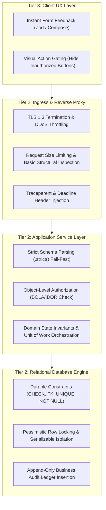
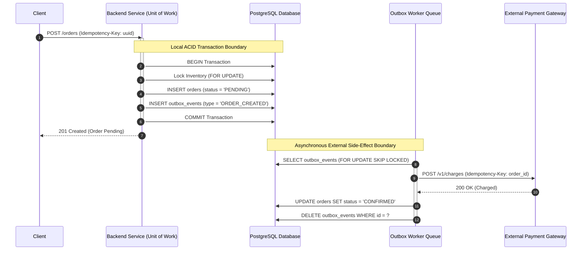
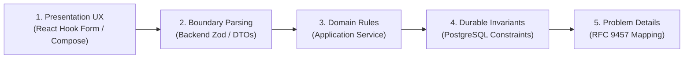
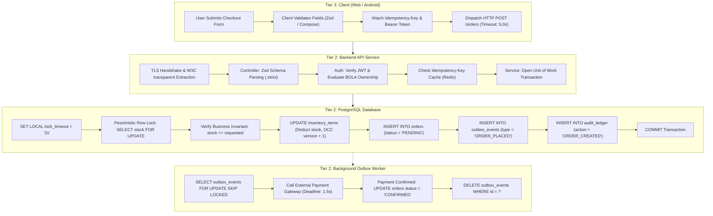

# Tier 2 Cross-Domain Consistency & Integration Standards

> **Level 2 Technology Standard — Cross-Domain Integration Layer**  
> **Applicability**: Mandatory for all full-stack and multi-tier features spanning Web/Android clients, Backend APIs, relational databases, and background asynchronous workers. Adheres to [Universal Core Standards](../01-principles/README.md) and [AGENTS.md](../AGENTS.md).

---

## 1. Architectural Framework & Authoritative Ownership Matrix (Requirement A)

When building distributed systems across multiple technology tiers (Web, Mobile, Backend, Database), identical concerns—such as validation, authorization, transactions, and state management—are evaluated at multiple layers. 

To eliminate ambiguous responsibility, duplicate validation bugs, and security vulnerabilities, the playbook establishes the **Principle of Single Authoritative Ownership**: for every system concern, exactly one layer owns the immutable, authoritative decision. All other layers act as convenient UX accelerators or secondary consumers.

### The 4-Dimensional Ownership & Enforcement Matrix

| Architectural Concern | Policy Owner (Rule Authority) | Source of Truth (Authoritative State) | Enforcement Layer(s) (Defense-in-Depth) | Validation & Enforcement Responsibilities Across Tiers |
| :--- | :--- | :--- | :--- | :--- |
| **Data Integrity & Relational Invariants** | Domain Architect & Data Governance Lead | Relational Database Engine (`PostgreSQL 16+`) | Client UX (advisory) $\to$ Backend DTOs (fail-fast) $\to$ Domain Entities $\to$ Database Constraints (authoritative) | **Client**: Instant user feedback; **Gateway**: Payload envelope limits; **Backend**: Contextual business invariant validation; **Database**: Final durable `CHECK`, `UNIQUE`, `FOREIGN KEY`, and `NOT NULL` constraints. |
| **Request Schema & Boundary Serialization** | API Platform Lead & Backend Architect | OpenAPI 3.1 Contract / Strict Schema (Zod / Go Validator) | Client Form Parsers (UX) $\to$ Reverse Proxy / Gateway $\to$ Backend Controller (authoritative) | **Client**: Guides input entry; **Gateway**: Drops malformed JSON transport envelopes; **Backend**: Strict parsing (`.strict()`), fails fast with RFC 9457 (400/422), suppresses raw internal stack traces. |
| **Business Transaction Boundaries & Atomicity** | Domain / Application Architect | Backend Application Service (Unit of Work) | Backend Application Service $\to$ Database Local ACID Engine $\to$ Transactional Outbox | **Client**: Supplies mutation intent with `Idempotency-Key`; **Service**: Orchestrates Unit of Work, manages connection leases, locks aggregates; **Database**: Commits atomic ACID transaction; **Worker**: Dispatches outbox events. |
| **Object-Level Authorization (BOLA/IDOR)** | Product Security & Access Governance | Identity Provider (JWKS) & Authorization Store (RBAC/ABAC) | Client UI State (visual gating) $\to$ Gateway Token Introspection $\to$ Service Domain Logic (authoritative) | **Client**: Conditionally renders UI actions (zero security guarantee); **Gateway**: Authenticates JWT signatures; **Service**: Verifies `subject_id` owns or is permitted on target `resource_id` before invoking database. |
| **Authentication, Token Lifecycle & Sessions** | Information Security Officer (CISO) & Identity Architect | Central Identity Provider / PostgreSQL `refresh_token_families` | Client Secure Vault $\to$ Backend Auth Controller $\to$ Database Token Family Table | **Client**: Stores tokens in Android KeyStore or `HttpOnly; Secure; SameSite=Strict` cookies; **Auth Service**: Verifies cryptographic signatures and single-use rotation; **Database**: Tracks token-family state machines. |
| **Audit Ledger & Regulatory Compliance** | Legal, Compliance & SecOps | Relational Database Append-Only `audit_ledger` Table | Backend Service $\to$ Database Local ACID Transaction $\to$ SIEM / APM Tracing | **Service**: Captures actor context, sanitizes PII, computes delta; **Database**: Atomically commits append-only `audit_ledger` entry; **APM**: Retains operational distributed traces (`traceparent`). |
| **Timeout & Deadline Hierarchy** | Systems Reliability & Platform Lead | Upstream Ingress / Client Request Origin | Client HTTP Client $\to$ API Gateway $\to$ Application Worker $\to$ Database Engine | **Client**: Sets global budget (5.0s); **Gateway**: Ingress deadline (4.0s) & propagates `X-Request-Deadline`; **Service**: Propagates cancellation; **Database**: `statement_timeout` (2.0s) & cancels active query on client disconnect. |
| **Entity State Caching & Invalidation** | Application Architecture & Performance Lead | Primary Database (state) + Redis (authoritative cache store) | Backend Write-Through Service $\to$ Redis Cache $\to$ Client Store (TanStack/Room) | **Backend**: Updates cache write-through/invalidation (TTL); **Redis**: Serves high-throughput read hits; **Client**: Maintains transient local cache for offline fluidity and optimistic UI rendering. |

### 1.1 The Distributed Enforcement Model & Defense-in-Depth

A critical pitfall in multi-tier architecture is confusing **Single Source of Truth** with **Single Point of Enforcement**:
* **Single Source of Truth** mandates that only *one* component holds final authority over an invariant. The relational database holds final authority over relational consistency; the service layer holds final authority over domain state transitions.
* **Defense-in-Depth Enforcement** requires *multiple* layers to inspect requests along the execution pipeline. Having the client validate email formatting does not duplicate database authority—it improves user experience by eliminating a 200ms network round-trip. Having the API Gateway throttle unauthenticated IPs does not replace application authorization—it shields the database connection pool from volumetric exhaustion.



---

## 2. Cross-Domain Conflict & Harmonization Matrix (Requirement B)

A system composed of individually reasonable technology-specific defaults can fail catastrophically when integrated. This matrix identifies conflicting defaults across the Android, Web, Backend, and Database guides, and establishes the binding harmonized standard.

| Dimension | Android Default | Web Default | Backend Default | Database Default | Harmonized Standard & Rationale |
| :--- | :--- | :--- | :--- | :--- | :--- |
| **Network Request Timeouts** | OkHttp: 30s read/write | Axios/Fetch: 10–15s | Axios/Undici: 5–10s | Statement: 5–10s | **Unified Deadline Budget**: Mobile/Web Client = 5.0s, Backend Ingress = 4.0s, DB Statement = 2.0s, Downstream HTTP = 1.5s. Eliminates wasted DB execution after client drops. |
| **Error Response Format** | Kotlin Exception / Result | Axios Error / ErrorBoundary | RFC 9457 Problem Details | SQLSTATE / Postgres Error Codes | **RFC 9457 Problem Details (`application/problem+json`)**: Backend intercepts SQLSTATE/Domain errors and maps them to standard JSON (`type`, `title`, `status`, `detail`, `instance`, `code`). Database schema names and raw SQL are strictly suppressed. |
| **Auth Token Lifespans** | Android Keystore | Browser Memory / Cookie | Access: $\le 15\text{m}$, Refresh: 7–30d | Token Family Table | **Coordinated Token Lifecycle**: Access token = 15m (stateless verification via JWKS). Refresh token = 7d (stateful, single-use, rotating). Client refresh grace period = 30s for concurrent mobile requests. |
| **Monetary Precision & Rounding** | Kotlin `BigDecimal` or Cents | TS `number` / `BigInt` | TS `bigint` / Zod | Postgres `BIGINT` / `NUMERIC` | **Explicit Minor Units & Domain Rounding**: Store integer minor units (`BIGINT`) with ISO 4217 currency code and explicit scale (USD = 2, JPY = 0, KWD = 3). Use `NUMERIC(28,8)` for intermediate calculations. Rounding mode is a business/regulatory rule (Banker's vs Half-Up), executed strictly at boundary. |
| **Timestamp Semantics** | `java.time.Instant` | ISO-8601 String / `Date` | UTC ISO-8601 String | `TIMESTAMPTZ` (UTC) | **Semantic Timestamp Separation**: System events & audit ledgers = `TIMESTAMPTZ` (UTC instant). Real-world calendar appointments = Local wall-clock timestamp + explicit IANA timezone name. Display conversion occurs at edge. |
| **Mutation Idempotency** | UUID header | UUID header | SHA-256 fingerprint check | Unique constraint on key | **Effectively-Once Mutation**: Client sends `Idempotency-Key: <UUIDv7>`. Backend records payload hash (SHA-256) and caches response for 24h. Database enforces unique constraint `(org_id, idempotency_key)`. |
| **Retry Backoff & Jitter** | Exponential (3 retries) | React Query: 3 retries | Exponential with jitter | Driver connection retry | **Full Jitter Exponential Backoff**: Retries permitted only on idempotent operations (GET, PUT, DELETE) or network disconnects. Max 3 retries with random full jitter ($t = \text{random}(0, \min(M, B \times 2^i))$). |

### 2.1 Financial Rounding Policy & Regulatory Nuance Standard

A frequent architectural failure is treating financial rounding as an arbitrary engineering choice. Rounding is a **legal, regulatory, and business domain rule** that must be explicitly governed:

1. **Banker's Rounding (`ROUND_HALF_EVEN`)**:
   * *Mechanism*: Rounds half-way values to the nearest even number (e.g., $2.5 \to 2$, $3.5 \to 4$).
   * *Domain Application*: High-volume financial transactions, statistical calculations, foreign exchange trading, and general ledger reconciliation. It eliminates the upward statistical bias inherent in commercial rounding over millions of transactions.
2. **Commercial / Retail Tax Rounding (`ROUND_HALF_UP`)**:
   * *Mechanism*: Rounds half-way values away from zero (e.g., $2.5 \to 3$, $3.5 \to 4$).
   * *Domain Application*: Consumer sales tax, VAT invoicing, and retail receipts where statutory law explicitly mandates commercial rounding (e.g., UK HMRC VAT Notice 700, IRS retail guidelines, and EU VAT Directive 2006/112/EC).
3. **The Pipeline Rounding Stage Invariant**:
   * **Intermediate Calculations**: `MUST NEVER` apply premature rounding. Retain full precision throughout the pipeline using `NUMERIC(28, 8)` in PostgreSQL, `BigDecimal` in Kotlin/Java, or high-precision decimal libraries in TypeScript.
   * **Boundary Execution**: Rounding `MUST` occur exactly once: at the final customer display, invoice generation, or statutory ledger posting boundary.

```
+----------------------------------------------------------------------------------+
|                            CALCULATION PIPELINE                                  |
|                                                                                  |
|  Item Price (cents): 1250 ($12.50)                                               |
|  Quantity: 3                                                                     |
|  Tax Rate: 8.875%                                                                |
|                                                                                  |
|  1. Subtotal:              1250 * 3 = 3750 ($37.50)                              |
|  2. Unrounded Tax:         3750 * 0.08875 = 332.8125 cents (Retained in full)    |
|  3. Final Boundary Round:  Tax Authority specifies ROUND_HALF_UP                |
|                            332.8125 -> 333 cents ($3.33)                         |
|  4. Durable Persistence:   Record integer 3750, integer 333, Total: 4083 cents   |
+----------------------------------------------------------------------------------+
```

---

## 3. Workstream F11: Transaction & Unit-of-Work Boundaries

### The Core Architectural Problem
Where does a business operation begin and end, and which layer owns its atomicity?

A distributed transaction hazard occurs when an application service updates a local database table and simultaneously invokes an external third-party API (e.g. Stripe payment, Twilio SMS, Kafka topic publication). **A relational database transaction cannot atomically commit an external network call.** If the payment succeeds but the local transaction rolls back, or if the database commits but the network fails, the system enters an inconsistent, corrupt state.



### The Transactional Outbox Pattern
To guarantee consistency across system boundaries, all asynchronous side effects `MUST` utilize the **Transactional Outbox Pattern**:
1.  **Atomic Event Persisting**: In the same local database transaction that updates business entities (`orders`, `accounts`), write an event record into an append-only `outbox_events` table.
2.  **Zero Network Calls Inside DB Transactions**: External HTTP calls, messaging publishes, and email transmissions are strictly forbidden inside `BEGIN ... COMMIT` blocks.
3.  **Outbox Poller / CDC Worker**: A separate background worker reads unpublished outbox rows using `SELECT ... FOR UPDATE SKIP LOCKED`, dispatches them over the network with an explicit timeout, and deletes or marks them published upon confirmation.
4.  **Idempotent Downstream Receivers**: Network messages may be delivered more than once during worker crashes. All downstream consumers `MUST` enforce deduplication using message IDs or entity version checks.

### 3.1 Real-World Operational Realities & Failure Modes of the Outbox

While the theoretical pattern is simple, production outbox implementations face five distinct operational failure modes that must be proactively mitigated:

```
+-------------------------------------------------------------------------------------------------------+
|                                    OUTBOX OPERATIONAL LIFECYCLE                                       |
|                                                                                                       |
|  [Business TX] --> (INSERT outbox_events)                                                             |
|                          |                                                                            |
|                          v                                                                            |
|  [Poller Worker] -> (SELECT ... FOR UPDATE SKIP LOCKED WHERE status = 'PENDING' ORDER BY id ASC)      |
|                          |                                                                            |
|                          +--> (Network Dispatch: Kafka / SQS / Webhook)                               |
|                                    |                                                                  |
|               +--------------------+---------------------+                                            |
|               | (Success)                                | (Failure)                                  |
|               v                                          v                                            |
|        [UPDATE status = 'PUBLISHED']              [Increment retry_count]                             |
|        [Set published_at = NOW()]                 [Backoff: 2^n * base_ms]                            |
|               |                                          |                                            |
|               v                                          +--> (If retry_count >= 5)                   |
|        [Archival / Pruning Job]                                      |                                |
|        (Purge after 7 days)                                          v                                |
|                                                               [UPDATE status = 'FAILED_DLQ']          |
|                                                               [Fire P1 Alert to SecOps/SRE]           |
+-------------------------------------------------------------------------------------------------------+
```

1. **At-Least-Once Delivery & Worker Crash Window**:
   * *The Problem*: A worker successfully dispatches an event to Stripe or Kafka, but crashes (or suffers a network disconnect) *before* committing the database transaction that updates the event to `PUBLISHED` or deletes it. When the worker recovers (or a peer worker takes over), it re-reads the event and dispatches it a second time.
   * *Mitigation*: Systems cannot guarantee *exactly-once* delivery across network boundaries. Systems `MUST` accept *at-least-once* transport and enforce **Consumer Idempotency**.
2. **Downstream Consumer Deduplication (The Inbox Pattern)**:
   * *The Mechanism*: Every downstream message consumer `MUST` implement deduplication before applying domain logic.
   * *Schema Enforcement*: Store processed event IDs in an append-only `processed_events` table within the consumer's local database transaction:
     ```sql
     CREATE TABLE processed_events (
         event_id UUID PRIMARY KEY,
         source_service TEXT NOT NULL,
         processed_at TIMESTAMPTZ NOT NULL DEFAULT CURRENT_TIMESTAMP
     );
     ```
   * *Execution*: The consumer checks `INSERT INTO processed_events (event_id, source_service) VALUES ($1, $2) ON CONFLICT DO NOTHING`. If zero rows are inserted, the event is recognized as a duplicate and silently acknowledged without re-executing business side effects.
3. **Message Ordering Guarantees via Partition Keys**:
   * *The Problem*: Multi-threaded outbox workers pulling batches of events concurrently can process events out of order (e.g., dispatching `ORDER_CANCELLED` before `ORDER_CREATED` has completed).
   * *The Rule*: Outbox rows `MUST` include a `partition_key` (typically the aggregate root UUID, e.g. `order_id` or `account_id`). Workers either route events to Kafka/SQS FIFO topics partitioned by this key, or enforce sequential row processing per `partition_key` so that all events for a single business entity are delivered strictly in timestamp order.
4. **Poison Message Handling & Exponential Backoff / Dead-Letter Queue (DLQ)**:
   * *The Problem*: If a single event payload is unparseable or rejected with a permanent `400 Bad Request` by a downstream API, a naive loop will retry indefinitely, blocking that partition's entire queue.
   * *Mitigation*:
     * Classify errors into **Transient** (503 Service Unavailable, network timeout) vs. **Permanent** (400 Bad Request, schema violation, invalid credentials).
     * Permanent errors immediately transition to `FAILED_DLQ` without retries.
     * Transient errors retry with exponential backoff and jitter up to a maximum limit (e.g., 5 attempts over 15 minutes). Once exhausted, the event transitions to `FAILED_DLQ` and triggers an actionable alert.
5. **Automated Table Cleanup & Archival Policy**:
   * *The Problem*: A high-throughput outbox table inserting millions of rows weekly suffers index bloat, vacuum degradation, and sequential scan slowdowns if historical records accumulate indefinitely.
   * *Mitigation*:
     * High-volume systems `MUST` partition the `outbox_events` table by day (`PARTITION BY RANGE (created_at)`), dropping partitions older than 7 or 14 days with zero lock overhead.
     * Medium-volume systems `MUST` run a scheduled, throttled batch cleanup job during off-peak windows:
       ```sql
       -- Throttled cleanup query preventing lock escalation
       DELETE FROM outbox_events
       WHERE id IN (
           SELECT id FROM outbox_events
           WHERE status = 'PUBLISHED' 
             AND published_at < CURRENT_TIMESTAMP - INTERVAL '7 days'
           LIMIT 5000
       );
       ```

---

## 4. Workstream F12: Validation & Error Representation Consistency

### The 5-Stage Validation Lifecycle



1.  **Stage 1: Presentation UX Validation (Client Layer)**:
    *   *Purpose*: Instant feedback, accessible inline error messages, and form usability.
    *   *Tools*: React Hook Form + Zod (Web), Compose state validation (Android).
    *   *Security Invariant*: Client validation is purely a user experience convenience. It provides **zero security protection**.
2.  **Stage 2: API Boundary Schema Parsing (Backend Controller)**:
    *   *Purpose*: Fail-fast rejection of malformed JSON payloads, type mismatches, and extraneous unexpected fields.
    *   *Tools*: Strict Zod schemas with `.strict()`, Go validator, or Bean Validation.
    *   *Outcome*: Invalid requests terminate immediately at the transport layer with `400 Bad Request` or `422 Unprocessable Content`.
3.  **Stage 3: Domain Rule Validation (Application Service)**:
    *   *Purpose*: Verifying contextual business rules across aggregate entities (e.g., account balance sufficiency, order item stock availability, duplicate state transitions).
    *   *Outcome*: Domain rule failures throw typed domain exceptions (e.g. `InsufficientInventoryException`) without invoking raw database queries.
4.  **Stage 4: Durable Invariant Enforcement (Relational Database)**:
    *   *Purpose*: Final, immutable defense against race conditions, out-of-order execution, and rogue SQL scripts.
    *   *Tools*: `NOT NULL`, `CHECK (quantity > 0)`, `UNIQUE (org_id, email)`, Foreign Keys with `ON DELETE RESTRICT`.
    *   *Outcome*: Any concurrent race condition that bypasses application checks is trapped by the database engine.
5.  **Stage 5: Standardized Error Representation (RFC 9457)**:
    *   *Purpose*: Unified error contracts across all clients.
    *   *Information Leakage Defense*: Database engine errors (e.g. `duplicate key value violates unique constraint "uq_users_email"`) `MUST NEVER` be returned directly to the client. The backend catches SQLSTATE errors and maps them to generic Problem Details:

```json
{
  "type": "https://api.example.com/errors/conflict",
  "title": "Resource Conflict",
  "status": 409,
  "detail": "An account with the specified email address already exists.",
  "instance": "/accounts",
  "code": "ACCOUNT_EMAIL_ALREADY_EXISTS"
}
```

---

## 5. Workstream F13: Authentication, Revocation & Token-Family Storage

### End-to-End Authentication Lifecycle

```mermaid
sequenceDiagram
    autonumber
    participant Client as Web / Android Client
    participant API as Backend Auth Server
    participant DB as PostgreSQL Database

    Note over Client,DB: 1. Login & Token Family Initialization
    Client->>API: POST /auth/login (credentials)
    API->>DB: Verify credentials & Check lockout
    API->>DB: INSERT INTO refresh_token_families (family_id, user_id)
    API->>DB: INSERT INTO refresh_tokens (token_hash, family_id, expires_at)
    API-->>Client: Return Access Token (15m JWT) + Refresh Token (7d Opaque)

    Note over Client,DB: 2. Normal Atomic Token Rotation
    Client->>API: POST /auth/refresh (Refresh Token R1)
    API->>DB: BEGIN Transaction
    API->>DB: SELECT * FROM refresh_tokens WHERE token_hash = SHA256(R1) FOR UPDATE
    Note over API,DB: Mark R1 as used; Issue R2 in same family
    API->>DB: UPDATE refresh_tokens SET is_used = TRUE WHERE id = ?
    API->>DB: INSERT INTO refresh_tokens (token_hash = SHA256(R2), family_id)
    API->>DB: COMMIT Transaction
    API-->>Client: Return New Access Token + New Refresh Token R2

    Note over Client,DB: 3. Token Reuse Attack Detection (Compromise Response)
    Client->>API: POST /auth/refresh (Attacker replays R1)
    API->>DB: SELECT * FROM refresh_tokens WHERE token_hash = SHA256(R1)
    Note over API,DB: R1 was already marked is_used = TRUE!
    API->>DB: UPDATE refresh_token_families SET is_revoked = TRUE WHERE family_id = ?
    API-->>Client: 401 Unauthorized (Entire session family revoked!)
```

### 5.1 Formal Token-Family State Machine

A refresh token exists within a strictly governed lifecycle state machine designed to detect credential theft and token replays:

```mermaid
stateDiagram-v2
    [*] --> ISSUED: Initial Login or Successful Refresh
    ISSUED --> ACTIVE: Token delivered to client storage
    ACTIVE --> CONSUMED: Rotated via /auth/refresh (Generates new ISSUED token)
    ACTIVE --> REVOKED: Explicit user logout or security invalidation
    CONSUMED --> REVOKED: Replay attack detected (Consumed token presented again)
    REVOKED --> [*]: Entire token family invalidated; user re-auth required
```

| Lifecycle State | Description | Invariant & Permitted Transitions |
| :--- | :--- | :--- |
| **`ISSUED`** | Cryptographically generated token hash persisted in database; pending delivery to client. | Can transition only to `ACTIVE` upon successful HTTP response delivery, or expired if never acknowledged. |
| **`ACTIVE`** | The single valid refresh token for the active user session family. | Can transition to `CONSUMED` via atomic rotation, or `REVOKED` via explicit logout. |
| **`CONSUMED`** | Previously valid token that has been replaced by a successor token. | Retained for concurrency grace period. If presented after grace period or re-presented maliciously, triggers immediate family-wide revocation to `REVOKED`. |
| **`REVOKED`** | Permanently invalidated token and family. | Terminal state. Any request presenting a revoked token returns HTTP 401 and logs a security audit event. |

### 5.2 Concurrency Defense: Grace Periods vs. Atomic Database Advisory Locks

In production systems, mobile clients frequently fire concurrent HTTP requests (e.g., initial screen load fetching profile, notifications, and dashboard data simultaneously). If the access token has expired, all three requests will concurrently attempt to refresh using the exact same refresh token. Systems must choose between two distinct concurrency architectures:

1. **The Leeway Grace Period Approach (Standard for Mobile)**:
   * *Mechanism*: When token $R_1$ is rotated to $R_2$, $R_1$ enters `CONSUMED` state but records a `grace_expires_at = CURRENT_TIMESTAMP + INTERVAL '30 seconds'`. If a concurrent request presents $R_1$ within that 30-second window, the server does not treat it as an attack; instead, it returns the *already-issued* $R_2$ and new access token.
   * *Trade-Off & Security Risk*: Solves mobile network race conditions and dropped TCP ACK packets without client-side coordination. However, it creates a narrow **30-second window of vulnerability** during which a stolen token could theoretically be replayed alongside the legitimate user's request.
2. **The Atomic Single-Flight / Database Advisory Lock Approach (Zero Replay Tolerance)**:
   * *Mechanism*: The client enforces a local mutex/interceptor (e.g. OkHttp Authenticator or Axios interceptor) ensuring only one refresh request is dispatched over the wire at a time while other requests queue. Concurrently, the backend acquires an atomic advisory lock:
     ```sql
     -- Serializes refresh attempts for this specific family without table locks
     SELECT pg_advisory_xact_lock(hashtext(family_id::text));
     ```
   * *Trade-Off*: Completely eliminates any replay vulnerability window. However, under high network jitter or client concurrency, connection pool holding times increase, and if a client drops mid-refresh, queued requests may experience timeout cascades.
3. **Distributed Clock Skew Defense**:
   * *Invariant*: Token expiration checks `MUST NEVER` rely on application server wall clocks (which may drift across Kubernetes nodes). All evaluations `MUST` execute against database engine UTC time (`CURRENT_TIMESTAMP`).

### Security Invariants for Cross-Domain Authentication
1.  **Hashed Token Storage**: Refresh tokens `MUST NEVER` be stored in plaintext. The database stores cryptographic hashes (`SHA-256`) of the refresh token. A database dump reveals zero usable credentials.
2.  **Single-Use Atomic Rotation**: Every token refresh consumes the presented token and issues a replacement. Both actions occur in a single atomic database transaction.
3.  **Whole-Family Revocation on Reuse**: If a refresh token that was already consumed is presented outside the grace period or without lock coordination, the authentication service flags an active replay attack and **immediately revokes all active tokens in that entire family**, terminating the attacker's and legitimate user's sessions.
4.  **Client Storage Isolation**:
    *   *Web Browsers*: Refresh tokens `MUST` be stored in `HttpOnly; Secure; SameSite=Strict` cookies to block XSS exfiltration. Access tokens remain in memory.
    *   *Android*: Tokens `MUST` be stored in `EncryptedSharedPreferences` backed by the hardware **Android KeyStore** (MasterKey AES-256-GCM).

---

## 6. Workstream F14: Retry, Timeout & Circuit-Breaker Budgets

### The End-to-End Deadline Hierarchy
In a multi-tier architecture, every layer must enforce a strictly shorter timeout than its caller. If the mobile app times out after 3 seconds, a backend database query configured for 30 seconds will continue executing uselessly for 27 seconds, wasting CPU and memory on an abandoned client.

$$\text{Client (5.0s Total)} > \text{Ingress (4.0s Deadline)} > \text{DB Statement (2.0s)} > \text{Outbound HTTP (1.5s)}$$

### 6.1 Distributed Deadline Propagation & Cancellation Mechanics

Static timeouts defined independently per service fail in multi-tier distributed architectures. If each service in a 4-tier chain allows a static 5-second timeout, a lagging request can lock resources for 20 seconds. Systems `MUST` practice **Distributed Deadline Propagation**:

```
+---------------------------------------------------------------------------------------------------------+
|                                    DISTRIBUTED DEADLINE BUDGETING                                       |
|                                                                                                         |
|  [Client] ------------------> [API Gateway] -------------> [Backend Service] --------> [Database]      |
|  Budget: 5000ms               Budget: 4000ms               Budget: 2500ms              Budget: 2000ms   |
|  Elapsed: 0ms                 Elapsed: 40ms                Elapsed: 120ms              Elapsed: 200ms   |
|  Header:                      Header:                      Context:                    Config:          |
|  X-Request-Deadline: <T_end>  X-Request-Timeout-Ms: 3960   AbortSignal / ctx.Deadline  statement_timeout|
|                                                                                                         |
|  -- IF CLIENT DROPS (TCP RESET / USER NAVIGATES AWAY) ------------------------------------------------  |
|  [Client Closes Socket] ===>  [Gateway Aborts Signal] ===> [Service Cancels ctx] ====> [pg_cancel_backend]|
+---------------------------------------------------------------------------------------------------------+
```

1. **Standard Transport Headers**:
   * `X-Request-Deadline`: An absolute UTC ISO-8601 timestamp (e.g., `2026-11-03T14:30:05.500Z`) calculated at client dispatch ($t_{\text{now}} + \text{budget}$).
   * `X-Request-Timeout-Ms`: An integer millisecond budget passed downstream, decremented at each ingress hop by the elapsed processing time.
   * `W3C Baggage`: Optional standardization using `baggage: request.deadline=1730644205500`.
2. **Context Cancellation Mechanics Across Tiers**:
   * **Web / Browser (TypeScript)**:
     ```typescript
     // Web client creates an AbortController tied to the request deadline
     const controller = new AbortController();
     const timeoutId = setTimeout(() => controller.abort(new Error("Request deadline exceeded")), 5000);
     
     try {
       const res = await fetch("/api/v1/orders", {
         signal: controller.signal,
         headers: { "X-Request-Timeout-Ms": "4000" }
       });
     } finally {
       clearTimeout(timeoutId);
     }
     ```
   * **Android (Kotlin Coroutines)**:
     ```kotlin
     // Android coroutine enforces structured cancellation
     suspend fun placeOrder(request: OrderRequest): Result<OrderResponse> = withTimeoutOrNull(5000L) {
         // Cooperative cancellation automatically cancels the underlying OkHttp call if the parent scope finishes
         coroutineContext.ensureActive()
         apiService.submitOrder(request)
     } ?: Result.failure(TimeoutException("Global client timeout budget expired"))
     ```
   * **Backend Application Service (Node.js / Go)**:
     ```typescript
     // Backend extracts remaining timeout and creates a downstream AbortSignal
     const remainingMs = Math.min(4000, parseInt(req.headers["x-request-timeout-ms"] || "4000", 10));
     const downstreamSignal = AbortSignal.timeout(remainingMs);
     
     // Detect upstream client disconnect and abort downstream operations immediately
     req.on("close", () => {
       if (!res.writableEnded) {
         downstreamSignal.abort(new Error("Client abandoned connection"));
       }
     });
     ```
   * **Relational Database Engine (PostgreSQL)**:
     * When a client disconnects or the service deadline triggers, the connection pool driver `MUST NOT` leave the transaction running.
     * The database session sets `SET LOCAL statement_timeout = '2000';` at the start of each transaction.
     * If the backend worker thread is cancelled, the pool manager sends an explicit query cancellation (`pg_cancel_backend(pid)`) to PostgreSQL, halting table scans and releasing row locks immediately.

### Retry Safety Rules
1.  **Idempotent Methods Only**: Automatic retries are permitted `ONLY` on safe/idempotent HTTP methods (`GET`, `HEAD`, `PUT`, `DELETE`) or on network connection handshakes that failed before any bytes were transmitted.
2.  **Mutating Endpoints Require Idempotency Keys**: Automatic retries on `POST` or `PATCH` endpoints are strictly prohibited unless the request carries an `Idempotency-Key` header with effectively-once guarantees.
3.  **Full Jitter Exponential Backoff**: Retries `MUST` calculate delay using full jitter to break synchronization waves that cause server thrashing:
    $$t_{\text{sleep}} = \text{random}\left(0, \min(T_{\max}, T_{\text{base}} \times 2^{\text{attempt}})\right)$$
4.  **Circuit Breaker Integration**: Client and backend HTTP connectors `MUST` trip a circuit breaker when consecutive error rates exceed $50\%$ over a 10-second rolling window, failing fast immediately for 30 seconds before testing with a single probe request.

---

## 7. Workstream F15: PII Redaction & Audit Ledger Schemas

### Four-Tier Telemetry & Audit Taxonomy

To avoid polluting operational monitoring with sensitive data or filling regulatory ledgers with noisy debug logs, systems must separate telemetry into four distinct tiers:

| Telemetry Tier | Purpose & Audience | Retention Period | Storage Location | PII & Secret Treatment |
| :--- | :--- | :--- | :--- | :--- |
| **Operational Logs** | Developer debugging, error stack traces, request routing. | 7 to 30 days | Centralized Log Store (Elasticsearch / CloudWatch) | **Defense-in-Depth Scrubbing**: Passwords, tokens, credit cards, and full request bodies are banned from log statements. Regex scrubbers act as a safety net. |
| **Security Audit Events** | SecOps, intrusion detection, failed logins, permission denials. | 90 to 365 days | SIEM / Immutable Cloud Storage | Stores actor ID, IP address, user agent, event code. Masked email permitted; passwords and tokens strictly banned. |
| **Business Audit Ledger** | Legal, financial, and compliance system of record (SOX, GDPR). | 7 years (Statutory) | Relational Database (`audit_ledger` table) | Append-only. Captures entity ID, actor ID, action, timestamp, and **payload delta** (changed attributes only). PII encrypted at column level. |
| **Distributed Traces & Metrics** | APM latency analysis, service dependency graphs. | 7 to 14 days | Distributed Tracing (OpenTelemetry / Jaeger) | W3C `traceparent` propagation. Zero PII in span tags or metric dimensions. |

### Schema for Tamper-Evident Business Audit Ledger
```sql
CREATE TABLE audit_ledger (
    id BIGINT GENERATED ALWAYS AS IDENTITY PRIMARY KEY,
    entity_name TEXT NOT NULL,
    entity_id UUID NOT NULL,
    action TEXT NOT NULL,                         -- 'INSERT', 'UPDATE', 'DELETE'
    actor_id TEXT NOT NULL,                       -- Authenticated user ID or 'SYSTEM'
    client_ip TEXT NOT NULL,
    trace_id TEXT NOT NULL,                       -- W3C trace ID correlating to APM logs
    payload_delta JSONB NOT NULL,                 -- Captures only modified fields; ZERO secrets
    recorded_at TIMESTAMPTZ NOT NULL DEFAULT CURRENT_TIMESTAMP,
    
    CONSTRAINT chk_audit_delta_object CHECK (jsonb_typeof(payload_delta) = 'object')
);

CREATE INDEX idx_audit_ledger_lookup ON audit_ledger (entity_name, entity_id, recorded_at DESC);
```

---

## 8. Representative End-to-End Vertical Slice Walkthrough (Requirement C)

To prove that the cross-domain standards integrate cohesively into a working production flow, we trace a complete end-to-end transaction: **Order Placement and Stock Reservation**.



### Trace Step-by-Step Analysis
1.  **Client Layer (Web / Mobile)**:
    *   User fills checkout form. React Hook Form / Compose validates required fields and positive quantity instantly for UI feedback.
    *   Client generates a `UUIDv7` as `Idempotency-Key`.
    *   Client attaches `Authorization: Bearer <access_token>` from memory/EncryptedSharedPreferences.
    *   Client dispatches `POST /api/v1/orders` with an overarching **5.0-second deadline**.
2.  **Transport & Ingress Layer**:
    *   API Gateway terminates TLS 1.3, assigns or propagates `traceparent: 00-4bf92f3577b34da6a3ce929d0e0e4736-00f067aa0ba902b7-01`.
    *   Gateway sets request timeout to **4.0 seconds**.
3.  **Backend Controller Layer**:
    *   Zod boundary schema validates `order_items` array (non-empty, positive amounts, valid UUIDs). Malformed requests abort immediately with `422 Unprocessable Content`.
    *   JWT signature is validated against cached JWKS public keys. Object-level authorization confirms the user belongs to `organization_id`.
    *   Idempotency middleware computes SHA-256 fingerprint of the JSON body and checks Redis. If a duplicate in-flight request exists, it returns `409 Conflict`; if a cached response exists, it replays it immediately with `X-Cache: HIT`.
4.  **Application Service & Unit of Work Layer**:
    *   Acquires a pooled connection from PgBouncer/HikariCP ($\le 2\text{s}$ acquisition budget).
    *   Starts a database transaction: `BEGIN`.
    *   Sets `SET LOCAL lock_timeout = '2s';` and `SET LOCAL statement_timeout = '2s';`.
5.  **Database Execution Layer**:
    *   Acquires pessimistic row lock on target inventory item: `SELECT available_stock FROM inventory_items WHERE id = ? FOR UPDATE;`.
    *   If stock is insufficient, transaction rolls back cleanly; backend maps the exception to RFC 9457 Problem Details (`422 Unprocessable Content`, code: `INSUFFICIENT_STOCK`).
    *   Deducts inventory stock and increments OCC version: `UPDATE inventory_items SET available_stock = available_stock - ?, version = version + 1 WHERE id = ?;`.
    *   Inserts order with exact minor units: `INSERT INTO orders (id, total_amount_cents, currency, status, idempotency_key, idempotency_payload_hash) VALUES (...);`.
    *   Inserts transactional outbox event: `INSERT INTO outbox_events (aggregate_id, event_type, payload) VALUES (...);`.
    *   Inserts business audit ledger: `INSERT INTO audit_ledger (entity_name, entity_id, action, actor_id, trace_id, payload_delta) VALUES (...);`.
    *   Commits transaction atomically: `COMMIT;`.
6.  **Response & Observability Layer**:
    *   Controller stores response in idempotency cache and returns `201 Created` with `Location: /api/v1/orders/{id}` to the client.
    *   Structured JSON log is emitted to APM with `trace_id`, `duration_ms`, `order_id`, and all sensitive customer data sanitized.
7.  **Asynchronous Outbox Worker Layer**:
    *   Independent background worker polls outbox: `SELECT * FROM outbox_events ORDER BY created_at ASC LIMIT 10 FOR UPDATE SKIP LOCKED;`.
    *   Dispatches payment request to Stripe API carrying the order ID as Stripe's idempotency key with a **1.5-second timeout**.
    *   Upon payment success, updates order status to `CONFIRMED` and removes the outbox event in a single transaction.

### 8.1 Distinction Between Architectural Walkthrough & Executable Test Evidence

In strict accordance with Tier 1 Universal Engineering Standard Rule 4 (Verification Integrity):
* **The Architectural Walkthrough (above)**: Serves as the normative conceptual specification and structural sequence contract. It illustrates how client, gateway, backend controller, service layer, database, and background workers must interact.
* **The Executable Integration Test Harnesses (Reference Implementations)**:
  1. *Backend API & Domain Logic*: The API boundary parsing, BOLA ownership validation, idempotency caching, Unit of Work transaction boundaries, and RFC 9457 error mappings are concretely implemented in `06-technologies/backend/examples/representative-api.ts` and empirically verified by `06-technologies/backend/examples/representative-api.test.ts`.
  2. *Relational Database & Concurrency*: The PostgreSQL 16+ schemas, constraints, OCC version columns, pessimistic locks, outbox tables, and audit ledger are concretely implemented in `06-technologies/database/examples/representative-schema-and-migration.sql` and verified in CI via `06-technologies/database/examples/verify-postgres-runtime.sh`.
  3. *Workstation Offline Verifiers*: Workstations without Docker/Node.js execute contract and structural checks via `tools/test-backend-example.ps1` and `tools/test-database-example.ps1`.

---

## 9. Cross-Domain Verification Checklist

- [ ] **Authoritative Ownership Respected**: Every validation, authorization, and transactional decision is owned by exactly one layer according to the 4-Dimensional Ownership Matrix.
- [ ] **Unified Deadline Hierarchy Enforced**: Ingress timeout > Controller timeout > Database statement timeout > Outbound network timeout; context cancellation (`AbortSignal` / `ensureActive()`) propagates downstream.
- [ ] **Zero Database Error Leakage**: Raw database SQL errors, table names, and constraint identifiers are completely intercepted and mapped to RFC 9457 Problem Details.
- [ ] **Formal Token-Family State Machine Implemented**: Refresh tokens transition through `ISSUED` $\to$ `ACTIVE` $\to$ `CONSUMED`/`REVOKED`; token reuse immediately revokes the full session family.
- [ ] **Domain-Governed Financial Rounding**: Banker's Rounding vs. Commercial Round-Half-Up is selected according to statutory/business domain; intermediate calculations retain full decimal precision.
- [ ] **Outbox Pattern with Production Resilience**: Zero external network calls exist inside local DB transactions; consumers enforce inbox deduplication; poison messages route to DLQ.
- [ ] **Effectively-Once Mutation Semantics**: Critical POST/PATCH endpoints enforce `Idempotency-Key` headers backed by SHA-256 payload fingerprinting and database unique constraints.
- [ ] **Sanitized Telemetry & Tamper-Evident Audit**: Operational logs pass through PII redaction filters; regulatory business events write append-only records to `audit_ledger`.
- [ ] **Empirical Verification Executed**: Test suites in `representative-api.test.ts` and `verify-postgres-runtime.sh` pass with zero failures in CI/CD pipeline.
