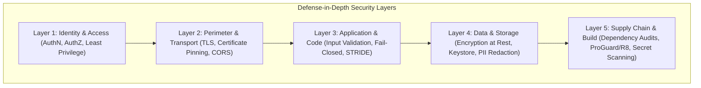

# Section 10: Universal Security & Privacy Engineering

> **Tier 1: Universal Engineering Core**  
> **Level 1 AI Instruction Baseline (Non-Overridable Safety Gate)**

---

## Overview

Security and privacy are not features to be bolted on at the end of a project; they are fundamental engineering disciplines that must be woven into every line of code, database query, and network request from day one (**Security by Design**).

In software engineering, the cost of fixing a vulnerability during requirements or architecture is negligible. The cost of fixing it after a production data breach involves regulatory fines, lost user trust, and emergency incident remediation.

This section establishes the universal security baselines and mental models required to protect your applications, users, and credentials across all software domains.

---

## The Defense-in-Depth Model

---

## Directory Catalog

| File | Topic | Core Focus |
| :--- | :--- | :--- |
| [01-credential-and-secret-management.md](01-credential-and-secret-management.md) | Credential & Secret Management | Zero hardcoded keys, hardware keystores, `.gitignore` safety |
| [02-authentication-and-authorization.md](02-authentication-and-authorization.md) | Authentication & Authorization | Token lifecycles, JWT safety, RBAC, least privilege |
| [03-input-validation-and-sanitization.md](03-input-validation-and-sanitization.md) | Input Validation & Sanitization | Fail-closed validation, SQL injection defense, boundary checks |
| [04-dependency-security-and-supply-chain.md](04-dependency-security-and-supply-chain.md) | Supply Chain & Dependencies | Lockfiles, CVE scanning, vetting third-party packages |
| [05-data-privacy-and-gdpr-principles.md](05-data-privacy-and-gdpr-principles.md) | Data Privacy & GDPR | Data minimization, user consent, right to erasure, encryption |
| [06-secure-logging-and-telemetry.md](06-secure-logging-and-telemetry.md) | Secure Logging & Telemetry | PII masking, token scrubbing, sanitized crash reporting |
| [07-threat-modeling-stride.md](07-threat-modeling-stride.md) | Threat Modeling (STRIDE) | 5-minute pragmatic STRIDE threat modeling for new features |
| [08-secure-configuration.md](08-secure-configuration.md) | Secure App Configuration | Disabling debug flags, Network Security Config, HTTPS |
| [09-api-and-database-security.md](09-api-and-database-security.md) | API & Database Security | Parameterized queries, rate limiting, database encryption |
