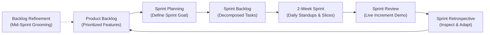
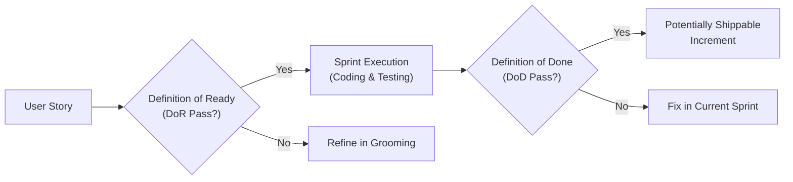
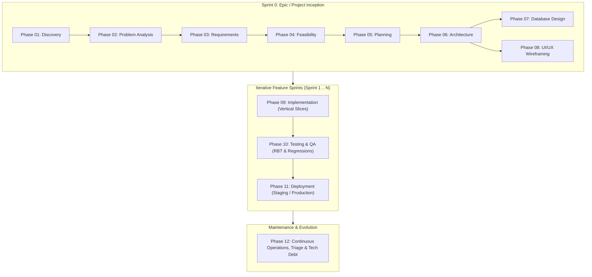

# Agile Engineering & Scrum Delivery Guide

> **Tier 1: Universal Engineering Guide**  
> **Status**: Authoritative Framework Standard  
> **Target Audience**: Software Engineers, Tech Leads, Scrum Masters, and AI Coding Agents

---

## 1. Executive Summary & Core Philosophy

Agile software engineering is an iterative, incremental approach to delivering high-quality software through continuous customer feedback, disciplined collaboration, and rapid response to change.

In modern AI-assisted engineering environments, AI coding agents dramatically accelerate the speed at which code is generated. However, without disciplined agile governance:
1. **Velocity Without Direction**: Accelerating development on poorly defined requirements simply builds the wrong product faster.
2. **Technical Debt Accumulation**: Rapidly generated code without strict acceptance gates creates unmaintainable architectures and hidden regressions.
3. **Scope Creep**: Lack of strict sprint timeboxing and backlog prioritization leads to sprawling, unfinished initiatives.

This guide defines how modern development teams and AI agents collaborate under the **Scrum Framework**, executing iterative sprints, conducting effective ceremonies, enforcing clear boundaries, and harmonizing agile delivery with the playbook's [12-Stage Software Development Lifecycle (SDLC)](../../02-lifecycle/README.md).

---

## 2. The 4 Agile Values for Modern Engineering

The Agile Manifesto establishes four foundational value pairs that govern all engineering decisions:

```
+---------------------------------------------------------------------------------------------------+
|                                  THE 4 CORE AGILE VALUES                                          |
|                                                                                                   |
|  1. Individuals and interactions  OVER  processes and tools                                      |
|  2. Working software              OVER  comprehensive documentation                              |
|  3. Customer collaboration        OVER  contract negotiation                                      |
|  4. Responding to change          OVER  following a plan                                          |
+---------------------------------------------------------------------------------------------------+
```

### Applying Agile Values to AI-Assisted Development
* **Individuals & Interactions**: AI agents assist developers; they do not replace human judgment, team consensus, or stakeholder collaboration.
* **Working Software**: Code is not "done" when the AI finishes writing text; it is done when verified by passing automated tests, linting, and smoke checks.
* **Customer Collaboration**: Rapid prototyping and short sprint feedback loops validate real user needs before large architectures are committed.
* **Responding to Change**: Modular code and clean separation of concerns enable the team to pivot features without massive rewrites.

---

## 3. The Scrum Framework & 2-Week Sprint Cadence

**Scrum** is the structured framework used to deliver software in recurring, timeboxed iterations called **Sprints** (recommended duration: **2 weeks**).



### The Sprint Goal: The Unifying North Star
Every sprint must define a clear, concise **Sprint Goal**—a 1–2 sentence statement articulating the primary business or technical value delivered by the iteration.
* **Good Sprint Goal**: *"Enable users to authenticate via Google OAuth and persist their basic profile in PostgreSQL with 100% token revocation test coverage."*
* **Bad Sprint Goal**: *"Work on JIRA tickets 104, 105, 112, and fix bugs."* (Task laundry list, no business focus).

---

## 4. The 5 Scrum Ceremonies

Scrum establishes five recurring ceremonies. Each ceremony has a strict timebox, distinct inputs, activities, outputs, and AI-agent integration points.

| Ceremony | Cadence | Timebox (2-Wk Sprint) | Primary Purpose | Key Output |
| :--- | :--- | :--- | :--- | :--- |
| **Sprint Planning** | Day 1 of Sprint | 2–4 hours | Agree on Sprint Goal & select backlog items | Sprint Goal & Sprint Backlog |
| **Daily Standup** | Daily (Mon–Fri) | 15 minutes | Align team progress & identify blockers | Blocker removal & daily commitments |
| **Backlog Refinement** | Mid-Sprint (Weekly) | 1 hour | Elaborate, estimate, and clarify user stories | INVEST-compliant user stories |
| **Sprint Review** | Last Day of Sprint | 1–2 hours | Inspect working increment with stakeholders | Stakeholder feedback & backlog updates |
| **Sprint Retrospective** | Last Day of Sprint | 1 hour | Inspect team process & commit to improvements | 1–3 concrete process action items |

---

### Ceremony 1: Backlog Refinement (Grooming)

* **Objective**: Prepare user stories so they are ready for upcoming sprints, preventing sprint planning delays.
* **Frequency**: Once per week or midway through the sprint.
* **Activities**:
  1. Break large epics down into small, vertical user stories ($\le 1-2$ days of implementation effort).
  2. Validate each story against the **INVEST** criteria:
     * **I — Independent**: The story can be implemented and tested without hard coupling to other concurrent stories.
     * **N — Negotiable**: The exact implementation details are open to developer-stakeholder collaboration.
     * **V — Valuable**: Delivers tangible value to the end user or technical infrastructure.
     * **E — Estimable**: The scope is clear enough for engineers to estimate effort accurately.
     * **S — Small**: Sized to fit comfortably within a single sprint (typically 1–3 story points or $\le 2$ days).
     * **T — Testable**: Contains unambiguous, verifiable acceptance criteria.
  3. Formulate Acceptance Criteria using the **Given-When-Then** (BDD) structure:
     ```gherkin
     Scenario: User submits checkout with expired credit card
       Given an authenticated user with items in their cart
       When the user submits payment with a card expiry date in the past
       Then the system rejects the transaction with HTTP 422
       And displays the error message "Card expiry date must be in the future"
       And retains the items in the user's cart
     ```
* **AI Agent Role**:
  * An AI agent (paired with the [Planning Agent](../../04-agents/roles/planning-agent.md)) can draft initial user stories, generate edge-case acceptance criteria, and detect ambiguous requirements.

---

### Ceremony 2: Sprint Planning

* **Objective**: Define what can be delivered in the sprint and how that work will be achieved.
* **Structure (Two Parts)**:
  1. **Part 1 (What)**: The Product Owner presents prioritized stories. The team clarifies requirements, checks the Definition of Ready, and negotiates scope until a realistic Sprint Goal is established.
  2. **Part 2 (How)**: Developers decompose stories into technical tasks ($\le 1$ day of effort), identify database migrations, API changes, and test requirements.
* **Capacity Planning**:
  * Base capacity on historical team **Velocity** (average completed story points per sprint), never on idealized 100% utilization.
  * Reserve a **Maintenance & Tech Debt Buffer** (recommended: **15–20% of capacity**) for unexpected bugs, dependency upgrades, and code refactoring.
* **AI Agent Role**:
  * Deconstruct user stories into explicit engineering task checklists (e.g. `implementation_plan.md`), identifying affected modules and risk-based test cases.

---

### Ceremony 3: Daily Standup (Daily Scrum)

* **Objective**: A daily alignment checkpoint for developers to synchronize work, identify blockers, and adjust their daily plan to achieve the Sprint Goal.
* **Strict Timebox**: 15 minutes. Not a detailed problem-solving meeting; deep architectural debates must be taken to post-standup breakout discussions ("parking lot").
* **The 3 Core Questions**:
  1. *What did I complete yesterday that helped the team meet the Sprint Goal?*
  2. *What will I work on today to help the team meet the Sprint Goal?*
  3. *What impediments or blockers are preventing me or the team from making progress?*
* **AI Agent Integration**:
  * In asynchronous or AI-augmented workflows, the [Scrum Master Agent](../../04-agents/roles/scrum-master-agent.md) parses git commits, open pull requests, and CI test logs to draft a 3-bullet asynchronous daily standup summary.

---

### Ceremony 4: Sprint Review (Demo)

* **Objective**: Present the working, tested product increment to stakeholders, celebrate progress, and collect empirical feedback.
* **Golden Rule**: **Only demo working software that meets the Definition of Done (DoD).** Never demo slide decks, mockups, or unverified branch code disguised as working features.
* **Activities**:
  1. Present the Sprint Goal and report whether it was achieved.
  2. Live demonstration of new features running on a staging environment or emulator.
  3. Discuss stakeholder questions, market changes, and user feedback.
  4. Adjust the Product Backlog for the next sprint based on findings.

---

### Ceremony 5: Sprint Retrospective

* **Objective**: Inspect how the last sprint went with respect to individuals, interactions, processes, tools, and the Definition of Done, then commit to actionable improvements.
* **Template**: Use the framework standard [`templates/15-RETROSPECTIVE_TEMPLATE.md`](../../templates/15-RETROSPECTIVE_TEMPLATE.md).
* **The 4 Standard Retrospective Prompts**:
  1. **What Went Well?**: Positive practices to continue.
  2. **What Could Be Improved?**: Friction points, communication breakdowns, flaky tests, unclear requirements.
  3. **What Puzzled Us?**: Unexpected technical surprises, external dependencies, velocity spikes/drops.
  4. **Action Items**: 1 to 3 concrete, assigned, timeboxed changes to execute during the next sprint.
* **AI Agent Health Check**:
  * Inspect AI agent performance during the sprint: Did agents hallucinate libraries? Did PR reviews catch actual bugs? Were prompt templates effective?

---

## 5. Scrum Roles & The Scrum Master's Mission

```
+---------------------------------------------------------------------------------------------------+
|                                     SCRUM ROLE BOUNDARIES                                         |
|                                                                                                   |
|  PRODUCT OWNER             SCRUM MASTER / AGILE COACH          ENGINEERING TEAM & AI AGENTS       |
|  "WHAT to build"           "HOW the team works"                "HOW to engineer & verify"        |
|  - Backlog prioritization  - Servant leader & coach            - Architectural design             |
|  - Vision & ROI            - Removes impediments & blockers    - Clean, tested implementation     |
|  - Acceptance criteria     - Shields team from distractions    - Definition of Done enforcement   |
|  - Release scheduling      - Facilitates ceremonies            - Estimations & code reviews       |
+---------------------------------------------------------------------------------------------------+
```

### The Scrum Master's Key Responsibilities
The **Scrum Master** is a servant leader who ensures the team adheres to agile values, practices, and rules:
1. **Impediment Removal**: Rapidly resolves organizational, technical, or dependency roadblocks that stall developers.
2. **Team Shielding**: Prevents external stakeholders from injecting mid-sprint scope changes or distracting developers from the Sprint Goal.
3. **Process Optimization**: Guides retrospectives and tracks engineering health metrics (cycle time, PR review turnaround, build success rate).
4. **AI Agent Governance**: Ensures AI coding tools comply with project rules, run verification suites, and do not introduce unapproved external dependencies.

*(For the specialized AI agent role, see [`04-agents/roles/scrum-master-agent.md`](../../04-agents/roles/scrum-master-agent.md)).*

---

## 6. Definition of Ready (DoR) vs. Definition of Done (DoD)

Quality in Scrum is guarded by two explicit binary quality gates:



### Definition of Ready (DoR) — Gate to Enter Sprint
A backlog item cannot be pulled into a sprint until it satisfies:
- [ ] Business value and user persona are explicitly stated.
- [ ] Meets INVEST criteria (independent, small $\le 2$ days, testable).
- [ ] Acceptance criteria written in unambiguous Given-When-Then format.
- [ ] External dependencies (APIs, third-party credentials, UX designs) are verified and available.
- [ ] Sized and estimated by the engineering team.

### Definition of Done (DoD) — Gate to Ship Increment
A user story cannot be marked as "Done" or demonstrated in the Sprint Review until it satisfies:
- [ ] Code implemented in compliance with Clean Code standards ([`01-principles/01-clean-code.md`](../../01-principles/01-clean-code.md)).
- [ ] Zero hardcoded secrets, API keys, or private tokens ([`AGENTS.md`](../../AGENTS.md) Rule 7).
- [ ] Unit tests written for core domain logic, edge cases, and error paths ([`AGENTS.md`](../../AGENTS.md) Rule 5).
- [ ] Passing all automated test suites and linting checks in CI.
- [ ] Peer code review completed and approved via Pull Request ([`templates/11-CODE_REVIEW_TEMPLATE.md`](../../templates/11-CODE_REVIEW_TEMPLATE.md)).
- [ ] Documentation updated (API contracts, changelogs, architecture records if applicable).
- [ ] Successfully deployed to staging or preview environment with zero regression errors.

---

## 7. Reconciling the 12-Stage SDLC with Agile Sprints

A common misconception is that a phased SDLC contradicts Agile. In reality, the playbook's [12-Stage SDLC](../../02-lifecycle/README.md) maps naturally into Agile sprint lifecycles:



### Sprint 0 (Inception Phase: SDLC Stages 1–8)
* **Goal**: Establish the architectural foundation, project repository, CI pipeline, database schema baseline, and initial backlog.
* **Duration**: 1–2 weeks (timeboxed; avoid prolonged "analysis paralysis").
* **Key Artifacts Produced**: Project Brief, SRS document, Architecture Design (SAD), Database ERD, CI pipeline configuration, and prioritized Product Backlog.

### Sprints 1 to N (Feature Delivery: SDLC Stages 9–11)
* **Goal**: Deliver vertical, end-to-end feature slices sprint after sprint.
* Each user story within a sprint traverses Phases 9, 10, and 11:
  * **Implementation (Phase 09)**: Developers and AI agents write clean, idiomatic code on short-lived feature branches following [Gitflow or Trunk-Based development](../../05-skills/git-and-version-control/SKILL.md).
  * **Testing & QA (Phase 10)**: Automated regression tests, boundary validation, and unit tests are written and executed before merging.
  * **Deployment (Phase 11)**: Merged code is automatically deployed to staging via CI/CD for validation.

### Maintenance & Technical Debt Management (SDLC Stage 12)
* Not an isolated post-project phase. During every sprint, allocate **15–20% of team capacity** to:
  * Upgrading external dependencies and runtime platforms.
  * Refactoring hotspots identified during sprint retrospectives.
  * Fixing non-critical bugs and addressing security advisories.

---

## 8. Branching & Release Strategy Alignment

Agile teams must pair their sprint cadence with an appropriate Git branching model:

* **Gitflow Workflow** ([`05-skills/git-and-version-control/SKILL.md`](../../05-skills/git-and-version-control/SKILL.md)):
  * **Best for**: Native Android/iOS apps, scheduled app store releases, and staged QA cycles.
  * Sprint work occurs on `feature/*` branches branched from `develop`.
  * At sprint end, a `release/*` branch freezes features, allows final QA testing and metadata preparation, and merges into both `main` (tagged with version) and `develop`.
* **Trunk-Based Development**:
  * **Best for**: Web frontend and cloud backend microservices practicing continuous deployment (CD).
  * Short-lived branches ($\le 1-2$ days) merge directly into `main` behind feature flags.

---

## 9. Agile Engineering Antipatterns & Pitfalls

| Antipattern | Description | Corrective Practice |
| :--- | :--- | :--- |
| **Water-Scrum-Fall** | Designing the entire system upfront for 3 months, then using 2-week sprints just for code generation. | Limit Sprint 0 to foundational architecture and use vertical user slices that test architectural assumptions early. |
| **Story Sprawl** | User stories that span multiple sprints without finishing. | Split stories using the SPIDR method (Spikes, Paths, Interfaces, Data, Rules) into 1–2 day chunks. |
| **Ignoring the DoD** | Marking stories "Done" with unwritten tests or broken CI to artificially inflate velocity. | Enforce automated CI blocking gates. No code merges without passing tests and reviews. |
| **AI Hallucination Thrash** | Letting AI agents generate hundreds of lines of untested code without incremental verification. | Enforce [AGENTS.md Rule 1 & 4](../../AGENTS.md): Inspect before modifying, plan first, verify every slice with real execution. |
| **No Retrospective Action** | Holding retrospectives where the same complaints are repeated but no action items are tracked. | Select only 1 to 3 measurable action items per retro and assign them to specific team members for the next sprint. |

---

## 10. Summary Checklist for Teams & Agents

- [ ] Every sprint begins with a single, clear **Sprint Goal**.
- [ ] User stories are refined against **INVEST** criteria before Sprint Planning.
- [ ] Acceptance criteria are defined in verifiable **Given-When-Then** format.
- [ ] Daily standups are strictly timeboxed to 15 minutes, focusing on commitments and blockers.
- [ ] A dedicated **15–20% capacity buffer** is reserved for maintenance and technical debt.
- [ ] The **Definition of Done** is strictly enforced; zero unverified or untested code is demonstrated.
- [ ] Sprint retrospectives produce 1–3 concrete, actionable process improvements.
- [ ] The team utilizes the [Scrum Master Agent](../../04-agents/roles/scrum-master-agent.md) and [Planning Agent](../../04-agents/roles/planning-agent.md) to automate administrative overhead while keeping human engineers in control.
