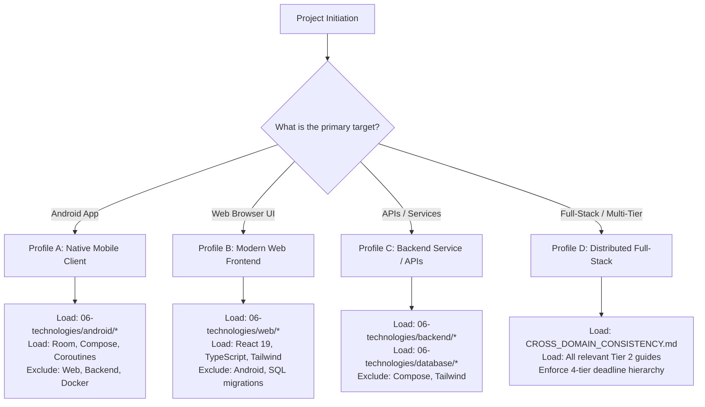

# Project Bootstrap & Delivery Lifecycle Workflow

> **The Reusable 8-Stage Operating Manual for Initiating, Architecting, Implementing, and Delivering Software with the Personal Engineering Playbook**  
> **Target Audience**: Intermediate Developers & AI Coding Agents  
> **Applicability**: Universal for any software project (Android, Web, Backend, Database, or Full-Stack).

---

## 1. Overview & Core Philosophy

This guide defines the complete end-to-end lifecycle for spinning up a new software project from scratch using the Personal Software Engineering Playbook. 

> [!TIP]
> **One-Command Automated Scaffolder**:
> Instead of manually copying directories and creating configuration files, you can scaffold a fully configured project repository (including `AGENTS.md`, `.agent/PROJECT.md`, multi-agent rules, Clean Architecture directories, CI workflows, and project tracking) in seconds using the interactive CLI utility:
> ```powershell
> # Interactive Scaffolder Wizard (prompts for optional tools)
> powershell -ExecutionPolicy Bypass -File .\tools\scaffold-project.ps1
> 
> # Direct Automated Command with Optional Tooling (CodeRabbit, Figma/MCP, BaaS, Skills & Vibe Coding Playbook)
> powershell -ExecutionPolicy Bypass -File .\tools\scaffold-project.ps1 `
>     -ProjectName "ZenithMobile" `
>     -Profile "android" `
>     -TargetDir "./zenith-mobile" `
>     -BaaS "supabase" `
>     -IncludeAgentDocs `
>     -IncludeCodeRabbit `
>     -IncludeMcp
> ```

Too many projects fail before writing code due to architectural churn, or fail during delivery due to missing gates, unverified AI code, or configuration drift. This workflow establishes a predictable, disciplined, and repeatable **8-Stage Path to Production**:

```
+-------------------------------------------------------------------------------------------------------------------+
|                                        THE 8-STAGE BOOTSTRAP LIFECYCLE                                            |
|                                                                                                                   |
|  [1. Initialize]  ==> [2. Classify]   ==> [3. Plan]       ==> [4. Architect]                                      |
|   Problem, Users,       Platform, Tech,    Brief, Scope,       Context, Data,                                     |
|   Constraints           Risk Profile       Requirements        APIs, ADRs                                         |
|                                                                     ||                                            |
|                                                                     \/                                            |
|  [8. Handover]    <== [7. Implement]  <== [6. Dev Setup]  <== [5. Agent Config]                                   |
|   Checklist, Runbook,   8-Step Quality     Repo Layout, CI,    Roles, Rules,                                      |
|   Retrospective         Gated Delivery     Linters, Secrets    Handoffs                                           |
+-------------------------------------------------------------------------------------------------------------------+
```

---

## Stage 1 — Project Initialization & Problem Discovery

Before writing documentation or code, establish the project's foundational purpose and boundaries.

### 1.1 Discovery Checklist
Capture the following core elements using [`templates/01-PROJECT_BRIEF_TEMPLATE.md`](../../templates/01-PROJECT_BRIEF_TEMPLATE.md):
1. **Problem Statement**: What specific user pain point, business inefficiency, or opportunity does this project address? (Avoid describing solutions; describe the problem).
2. **Target Users & Personas**: Who interacts directly with this system? (e.g., mobile end-user, administrative staff, machine-to-machine client).
3. **Core Value Proposition**: The single primary outcome that defines project success.
4. **Functional Requirements (MoSCoW)**:
   * **Must-Have**: Critical capabilities without which the project cannot launch.
   * **Should-Have**: Important features that add high value but can be deferred if deadlines compress.
   * **Could-Have**: Nice-to-have enhancements.
   * **Won't-Have (This Phase)**: Explicitly excluded features to prevent scope creep.
5. **Non-Functional Requirements (NFRs)**:
   * Availability targets (e.g., 99.9% uptime).
   * Latency budgets (e.g., p95 $\le 200\text{ms}$ on API responses, 60fps UI rendering).
   * Data sovereignty and regulatory bounds (e.g., GDPR, HIPAA, SOC 2).
   * Offline tolerance (e.g., mobile offline-first capability vs always-connected web).
6. **Hard Constraints & Budget**:
   * Deadlines, team size, cloud hosting budget, legacy system dependencies.
7. **Empirical Success Metrics**:
   * Measurable KPIs (e.g., $< 1\%$ crash rate, $> 80\%$ task completion, $< 2\text{s}$ app launch time).

---

## Stage 2 — Project Classification & Standards Selection

Not all projects require every standard in this playbook. A simple native Android utility does not need distributed outbox messaging; a microservice backend does not need Jetpack Compose stability guides. 

Use this classification decision tree to select the exact subset of Tier 1 and Tier 2 standards required:



### 2.1 Technology Selection Matrix

| Profile | Applicable Tier 1 Core | Applicable Tier 2 Extensions | Deliberately Excluded Standards |
| :--- | :--- | :--- | :--- |
| **A: Native Android Utility** | Principles, Lifecycle, Security, QA Gates | `06-technologies/android/` (all 8 guides) | Web, Backend APIs, PostgreSQL, Outbox, Docker |
| **B: Single-Page Web App** | Principles, Lifecycle, Security, QA Gates | `06-technologies/web/` (all 6 guides) | Android, Room, PostgreSQL, Distributed Outbox |
| **C: Headless Backend API** | Principles, Lifecycle, Architecture, Security | `06-technologies/backend/` + `database/` | Android Compose, React 19, Tailwind CSS |
| **D: Full-Stack Platform** | All Universal Modules (01–04, 08–10) | Android, Web, Backend, Database + Cross-Domain | None (requires strict cross-domain contract enforcement) |

---

## Stage 3 — Project Planning & Requirements Engineering

Translate discovered user requirements into actionable engineering artifacts before writing code.

### 3.1 Planning Milestones
1. **Instantiate the Project Brief**: Copy [`templates/01-PROJECT_BRIEF_TEMPLATE.md`](../../templates/01-PROJECT_BRIEF_TEMPLATE.md) into `docs/PROJECT_BRIEF.md`.
2. **Draft the Requirements Specification**: Copy [`templates/02-REQUIREMENTS_SPEC_TEMPLATE.md`](../../templates/02-REQUIREMENTS_SPEC_TEMPLATE.md) into `docs/REQUIREMENTS_SPEC.md`. Detail acceptance criteria using Given-When-Then (Gherkin) syntax.
3. **Partition into Milestones**: Group capabilities into distinct delivery phases ($\le 2$ weeks per milestone):
   * *Milestone 1*: Foundation, schema, core domain models, basic repository harness.
   * *Milestone 2*: Core happy-path user flows with automated unit/integration tests.
   * *Milestone 3*: Edge cases, error handling, security hardening, rate limiting.
   * *Milestone 4*: Polish, observability, performance tuning, release verification.
4. **Initialize Progress Tracking**: Create `PROJECT_PROGRESS.md` following [`02-lifecycle/05-project-planning.md`](../../02-lifecycle/05-project-planning.md) and [`templates/08-TASK_DEFINITION_TEMPLATE.md`](../../templates/08-TASK_DEFINITION_TEMPLATE.md) to maintain an accurate operational log.

---

## Stage 4 — Project Architecture & Technical Design

Establish the technical blueprints and record trade-offs before implementation.

### 4.1 Required Architectural Deliverables
1. **Technical Design Document (TDD)**: Copy [`templates/03-TECHNICAL_DESIGN_TEMPLATE.md`](../../templates/03-TECHNICAL_DESIGN_TEMPLATE.md) to `docs/TECHNICAL_DESIGN.md`.
2. **System Context & Component Diagrams**: Create C4 Level 1 (System Context) and Level 2 (Container) Mermaid diagrams.
3. **Data Model Design**: 
   * If relational: Copy [`templates/06-DATABASE_DESIGN_TEMPLATE.md`](../../templates/06-DATABASE_DESIGN_TEMPLATE.md) to `docs/DATABASE_DESIGN.md`. Include 3NF ERD, exact data types (`BIGINT`, `TIMESTAMPTZ`, `NUMERIC`), declarative check constraints, and composite indexes.
   * If mobile Room: Define `@Entity`, primary keys, and foreign key cascade rules.
4. **API Contract Specification**: Copy [`templates/05-API_SPECIFICATION_TEMPLATE.md`](../../templates/05-API_SPECIFICATION_TEMPLATE.md) to `docs/API_SPECIFICATION.md`. Define RFC 9457 error contracts, idempotency headers, and cursor pagination.
5. **Architectural Decision Records (ADRs)**: For any non-trivial choice (e.g. choosing Postgres over MongoDB, choosing TanStack Query over Redux, choosing Banker's Rounding over Half-Up), create an ADR using [`templates/04-ADR_TEMPLATE.md`](../../templates/04-ADR_TEMPLATE.md) in `docs/adr/`.

---

## Stage 5 — Agent Configuration & Role Governance

Equip AI coding agents (Google Antigravity, Cursor, Claude Code, GitHub Copilot) to operate safely within the project repository without drifting from engineering standards.

### 5.1 Step-by-Step Agent Onboarding
1. **Copy Universal Rules**: Copy [`AGENTS.md`](../../AGENTS.md) into the target project root.
2. **Create Project Overlay (`.agent/PROJECT.md` or local `CLAUDE.md`)**:
   Define the 4-Level Instruction hierarchy for the project:
   * *Level 1*: Inherit [`AGENTS.md`](../../AGENTS.md) invariants (Verification Integrity, Zero Silent Overwrites, Security by Default).
   * *Level 2*: Reference selected Tier 2 technology standards (e.g., Android Kotlin / Compose).
   * *Level 3*: Target project specifics (architecture type, naming conventions, target APIs).
   * *Level 4*: Task-specific roles (Planning, Coding, Review, Security).
3. **Configure Tool-Specific Adapters**:
   * For **Cursor**: Create `.cursorrules` pointing to `AGENTS.md` and Level 2 guides.
   * For **Claude Code**: Create `CLAUDE.md` specifying build commands, test commands, and lint scripts.
   * For **GitHub Copilot**: Create `.github/copilot-instructions.md`.
4. **Define Agent Permissions & Boundaries**:
   * *Permitted*: Reading codebase, creating feature files, writing automated unit tests, executing local test harnesses.
   * *Forbidden Without Explicit Human Approval*: `git commit`, `git push`, modifying CI workflows, updating production environment variables, deleting migration scripts.

---

## Stage 6 — Development Setup & Toolchain Initialization

Establish a reproducible, clean development environment with automated guardrails.

### 6.1 Toolchain Setup Checklist
1. **Standardized Directory Layout**:
   ```
   my-project/
   ├── .github/workflows/       # CI/CD pipelines
   ├── docs/                    # Architecture, ADRs, Specs
   │   ├── adr/
   │   └── reports/
   ├── src/ (or app/)           # Source code partitioned by clean layers
   ├── tests/                   # Unit, integration, and contract tests
   ├── templates/               # Project templates
   ├── AGENTS.md                # AI Agent governance rules
   ├── README.md                # Project entry point & Quick Start
   └── PROJECT_PROGRESS.md      # Operational tracking log
   ```
2. **Dependency Management**:
   * Android: `gradle/libs.versions.toml` Version Catalogs with strict dependencies.
   * Web/Node: `package.json` with exact versions (`npm ci` lockfile reproducibility).
3. **Secrets Hygiene**:
   * Create `.env.example` with dummy values.
   * Add `.env`, `local.properties`, `*.pem`, `*.key` to `.gitignore`.
   * Verify zero hardcoded API keys or passwords.
4. **Linters & Formatters**:
   * Kotlin: `ktlint` or `detekt`.
   * Web/TypeScript: `eslint` and `prettier`.
5. **CI/CD Quality Gate Workflow**:
   * Set up GitHub Actions workflow verifying: lint pass, build pass, automated tests pass, and zero secret leakage.

---

## Stage 7 — The Implementation Lifecycle (8-Step Quality Gate)

Every feature or bug fix must traverse the disciplined 8-Step Implementation Gate:

```
[Requirement] -> [Design] -> [Implement] -> [Test] -> [Review] -> [Security] -> [Document] -> [Deliver]
```

| Step | Gate Name | Core Activity | Mandatory Output / Evidence |
| :---: | :--- | :--- | :--- |
| **1** | **Requirement** | Review issue, clarify edge cases, verify scope. | Task definition in [`templates/08-TASK_DEFINITION_TEMPLATE.md`](../../templates/08-TASK_DEFINITION_TEMPLATE.md). |
| **2** | **Design** | Plan changes, identify target files, assess risks. | Plan artifact (`implementation_plan.md`). |
| **3** | **Implement** | Write clean, modular code following Tier 2 idioms. | Working code adhering to Clean Architecture & Single Responsibility. |
| **4** | **Test (RBT)** | Execute Risk-Based Testing: unit, domain, edge cases. | Reproducing test for bug fix; passing test suite logs. |
| **5** | **Code Review** | Peer review or AI review against QA checklist. | Completed [`templates/11-CODE_REVIEW_TEMPLATE.md`](../../templates/11-CODE_REVIEW_TEMPLATE.md). |
| **6** | **Security Check** | Scan for OWASP Top 10, BOLA/IDOR, PII leakage. | Completed [`templates/12-SECURITY_REVIEW_TEMPLATE.md`](../../templates/12-SECURITY_REVIEW_TEMPLATE.md). |
| **7** | **Documentation**| Update README, ADRs, or API contracts. | Updated documentation reflecting changes. |
| **8** | **Delivery** | Merge via PR, update progress tracking. | Status set to `Completed` in `PROJECT_PROGRESS.md`. |

---

## Stage 8 — Release, Verification & Handover

Deploy software reliably with zero surprises using standardized release and operational checklists.

### 8.1 Release Execution Steps
1. **Pre-Release Verification**: Complete [`templates/13-RELEASE_CHECKLIST_TEMPLATE.md`](../../templates/13-RELEASE_CHECKLIST_TEMPLATE.md):
   * All automated CI tests pass on clean clone.
   * Database migrations tested with expand-and-contract verification.
   * Version number bumped according to SemVer (`VERSION.md`).
   * `CHANGELOG.md` updated with release highlights.
2. **Rollback Strategy Ready**: Document exact rollback commands (e.g. revert commit, database down-migration, container image rollback).
3. **Smoke Testing**: Execute post-deployment smoke tests on staging/production.
4. **Operational Runbook**: Ensure monitoring dashboards, error alerts (Sentry / Datadog), and health checks (`/healthz`) are operational.
5. **Post-Mortem / Retrospective**: In the event of an outage, complete [`templates/14-INCIDENT_REPORT_TEMPLATE.md`](../../templates/14-INCIDENT_REPORT_TEMPLATE.md). At milestone completion, conduct a team review using [`templates/15-RETROSPECTIVE_TEMPLATE.md`](../../templates/15-RETROSPECTIVE_TEMPLATE.md).
