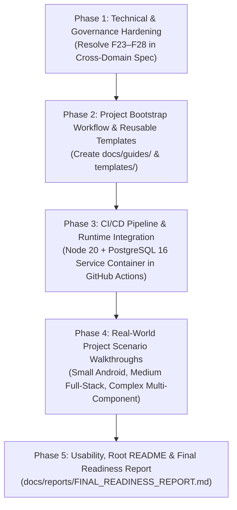

# Playbook Finalization Baseline & Gap Analysis Report

> **Document ID**: `FINALIZATION_BASELINE`  
> **Status**: Completed  
> **Author**: Principal Software Architect & QA Lead  
> **Repository Commit**: `0ee4832`  
> **Date**: 2026-11-03

---

## 1. Executive Summary

This baseline report audits the Personal Software Engineering Playbook repository at commit `0ee4832` to determine its actual readiness for real-world project initiation, execution, and delivery. 

While previous milestones (1 through 4.3) successfully established extensive engineering documentation, agent role guidelines, technology standards, and validation scripts, the repository currently functions primarily as an **authoritative reference library** rather than an **operational project bootstrap and delivery system**. 

To bridge the gap between documentation and real-world execution, this audit identifies the exact inventory, verified capabilities, critical missing components, known architectural findings (F23–F28), and the concrete roadmap required to achieve project readiness.

---

## 2. Actual Repository Inventory (Commit `0ee4832`)

The repository currently contains **128 tracked files** partitioned across governance, Tier 1 universal standards, Tier 2 technology standards, reference code artifacts, automation tools, and CI workflows:

| Category / Layer | Directory / File Path | File Count | Format / Scope |
| :--- | :--- | :---: | :--- |
| **Root Governance** | `/` (`README.md`, `AGENTS.md`, `VERSION.md`, etc.) | 6 | Markdown governance, agent invariants, version metadata, changelog, backlog |
| **Tier 1: Principles** | `01-principles/` | 13 | 9-part pedagogical schema guides for core principles (Clean Code, Modularity, Performance, etc.) |
| **Tier 1: Lifecycle** | `02-lifecycle/` | 13 | 12 SDLC phases (Inputs, Activities, Outputs, Gate Criteria) + Directory Index |
| **Tier 1: Architecture** | `03-architecture/` | 12 | 11 System architecture pattern guides (Clean, Layered, Event-Driven, Modular, etc.) + Index |
| **Tier 1: Agents** | `04-agents/` | 14 | 7 Agent role specifications, 4 tool adapters, interoperability matrix, agent rules |
| **Tier 1: Skills** | `05-skills/` | 14 | 12 Agent skills adhering to `agentskills.io` schema, integration scenarios, catalog index |
| **Tier 1: Security** | `10-security-and-privacy/` | 10 | 9 Universal security engineering guides (Secrets, Auth, Input Validation, Privacy, etc.) + Index |
| **Tier 2: Technology Index**| `06-technologies/README.md` | 1 | Technology roadmap, active status, normative agent cross-domain operating instructions |
| **Tier 2: Cross-Domain** | `06-technologies/CROSS_DOMAIN_CONSISTENCY.md` | 1 | Single-ownership matrix, conflict harmonization, F11–F15 specifications, vertical slice |
| **Tier 2: Android** | `06-technologies/android/` | 9 | 8 Android guides (Kotlin idioms, Compose, Coroutines, Room, Hilt, etc.) + Index |
| **Tier 2: Web Frontend** | `06-technologies/web/` | 7 | 6 Web guides (TypeScript, React 19, State, Modern CSS, CWV, Forms) + Index |
| **Tier 2: Backend & APIs** | `06-technologies/backend/` | 7 | 6 Backend guides (REST, Validation, Auth, Service Layer, Resilience, Observability) + Index |
| **Tier 2: Database** | `06-technologies/database/` | 8 | 7 Database guides (Governance, Modeling, Indexing, Migrations, Concurrency, Pooling, Security) + Index |
| **Subtotal Markdown** | — | **115** | Verified portable Markdown documents (0 broken links, 0 absolute file URI links) |
| **Reference Code & Config**| `06-technologies/*/examples/` | 6 | 1 Web TSX, 1 Backend TS, 1 Backend TS Test, 1 `package.json`, 1 `tsconfig.json`, 1 Database SQL |
| **Automation Tools** | `tools/` | 6 | PowerShell validation, positive fixture test, negative fixture test, backend verifier, database verifier, clean-clone harness |
| **CI Workflows** | `.github/workflows/` | 1 | GitHub Actions cross-platform validation workflow (`validate-playbook.yml`) |
| **Total Tracked Files** | — | **128** | Verified against `git ls-files` |

---

## 3. Existing Capabilities vs. Missing Capabilities

### A. Existing Strengths
1. **Comprehensive Educational Coverage**: 27 Tier 2 technology guides strictly conform to the 9-part pedagogical schema, providing actionable rationale, bad/good code examples, practical traps, and checklists.
2. **Automated Structural & Link Validation**: `tools/validate-playbook.ps1` verifies 115 Markdown documents, 167 relative links, 12 skill definitions against `agentskills.io` JSON schema, and version consistency in under 3 seconds.
3. **Clean-Clone Reproducibility**: `tools/test-clean-clone.ps1` verifies that a clean clone from Git produces identical commit SHAs and passes all validation suites.
4. **Architectural Hierarchy**: Clean separation of Tier 1 (Universal Core) and Tier 2 (Technology Standards) with an inviolable Iron Safety Gate preventing technology rules from bypassing universal safety.
5. **Cross-Domain Conceptual Alignment**: `CROSS_DOMAIN_CONSISTENCY.md` harmonizes defaults across timeouts, token rotation, minor units money, and logging.

### B. Missing Capabilities (Gaps to Close)
1. **Zero Project Templates (`templates/`)**: There is currently **no `templates/` directory** in the repository. A developer starting a new project has no copyable templates for Project Briefs, Requirements Specifications, Technical Design Documents, ADRs, Test Plans, or Release Checklists.
2. **Missing Project Bootstrap Workflow**: There is no end-to-end procedural guide detailing how to initialize a new repository, classify project complexity, select relevant Tier 1/Tier 2 standards, configure agent instructions (`CLAUDE.md`, `.cursorrules`, `.agent/PROJECT.md`), and execute the lifecycle.
3. **Lack of Local Runtime Execution Environment**:
   - The local Windows host environment currently lacks `node`, `npm`, `docker`, and `psql` in its system PATH.
   - While the reference code artifacts (`representative-api.ts`, `representative-api.test.ts`, `representative-schema-and-migration.sql`) are syntactically rich and verified by pattern checkers (`test-backend-example.ps1`, `test-database-example.ps1`), they have **not yet been executed against a real Node.js runtime or live PostgreSQL 16+ engine locally**.
4. **CI Workflow Gaps**:
   - `.github/workflows/validate-playbook.yml` only executes PowerShell test scripts.
   - It does not run `npm ci` or `npx vitest run` for the backend example.
   - It does not spin up a PostgreSQL service container to execute the SQL reference migration.
   - It lacks automated secret scanning or linting gates.
5. **Absence of Real-World Project Scenarios**: The repository has not been evaluated against realistic project profiles (Small Android utility, Medium Full-Stack web app, Complex Multi-Component platform) to verify usability and identify friction points.

---

## 4. Analysis of Known Technical & Governance Findings (F23–F28)

| Finding ID | Topic & Core Issue | Current Playbook Limitation | Required Resolution |
| :---: | :--- | :--- | :--- |
| **F23** | **Ownership & Enforcement Boundaries** | `CROSS_DOMAIN_CONSISTENCY.md` states "Relational Database owns Data Integrity Constraints" and "Backend API owns Request Validation", which can imply single-layer isolation rather than distributed defense-in-depth. | Decompose every concern into 4 explicit dimensions: (1) **Policy Owner** (who specifies the rule), (2) **Source of Truth** (where authoritative state persists), (3) **Enforcement Layer(s)** (where checks execute), and (4) **Validation Responsibilities** across tiers. |
| **F24** | **Refresh-Token Concurrency & Replay Protection** | Presents a 30-second grace period for concurrent mobile refresh requests as a default recommendation without detailing the security trade-off. | Formalize the token-family state machine: define atomic rotation, reuse detection, concurrent request handling, race-condition mitigation (atomic advisory locks vs grace periods), hashed token storage, and explicit threat-model trade-offs. |
| **F25** | **Financial Rounding Policy** | Prescribes Banker's Rounding (`ROUND_HALF_EVEN`) as a universal standard. | Clarify that rounding is a business and regulatory policy, not an arbitrary standard. Tax authorities (e.g. VAT/sales tax) often legally mandate Round-Half-Up, while financial conversions use Half-Even. Specify rounding stage (intermediate vs final) and policy ownership. |
| **F26** | **Distributed Deadline Propagation** | Establishes a static timeout hierarchy ($\text{Client 5s} > \text{Ingress 4s} > \text{DB 2s}$), but does not define how cancellation propagates down the call stack. | Detail context propagation (W3C trace context, `AbortSignal` in TS/Fetch, `context.Context` in Go, coroutine cancellation in Kotlin). When an upstream client cancels, downstream database queries and outbound HTTP calls must be aborted immediately. |
| **F27** | **Transactional Outbox Operational Realities** | Outbox pattern is presented conceptually without addressing at-least-once delivery duplicates, crash windows, ordering guarantees, poison message dead-lettering, or table cleanup. | Provide concrete operational rules: partition-key ordering, publisher crash recovery, consumer idempotency mechanisms, exponential retry with Dead-Letter Queue (DLQ), and automated vacuum/cleanup policies for processed outbox rows. |
| **F28** | **Executable Integration Evidence** | Section 8 of `CROSS_DOMAIN_CONSISTENCY.md` documents an architectural walkthrough of Order Placement, but it is a descriptive diagram rather than an executable integration test. | Distinguish documented architectural designs from executable integration tests. Build an executable integration test suite (or automated mock harness) and track real containerized execution in CI. |

---

## 5. What Is Documented vs. Implemented vs. Tested

| Layer / Feature Area | Documented Status | Implemented Status | Tested Status | Current Verification Evidence |
| :--- | :---: | :---: | :---: | :--- |
| **Tier 1 Principles (01)** | COMPLETE | N/A (Standards) | VERIFIED | Validated by `tools/validate-playbook.ps1` Test Suite 1 & 5 |
| **Tier 1 SDLC Lifecycle (02)**| COMPLETE | N/A (Workflows) | VERIFIED | Validated by `tools/validate-playbook.ps1` Test Suite 1 |
| **Tier 1 Architecture (03)** | COMPLETE | N/A (Patterns) | VERIFIED | Validated by `tools/validate-playbook.ps1` Test Suite 1 |
| **Tier 1 Agent Roles & Adapters (04)** | COMPLETE | COMPLETE | VERIFIED | 7 Roles, 4 Adapters, Interoperability Matrix verified |
| **Tier 1 Skills (05)** | COMPLETE | COMPLETE | VERIFIED | 12 Skills pass `agentskills.io` positive (6) & negative (17) tests |
| **Tier 1 Security & Privacy (10)** | COMPLETE | N/A (Standards) | VERIFIED | 9 Guides verified by link integrity checker |
| **Tier 2 Android Standards** | COMPLETE | N/A (Standards) | VERIFIED | 8 Guides pass 9-part pedagogical schema |
| **Tier 2 Web Standards** | COMPLETE | REFERENCE CODE | VERIFIED (Structure) | 6 Guides pass schema; `representative-feature.tsx` pattern verified |
| **Tier 2 Backend Standards** | COMPLETE | REFERENCE CODE | PARTIAL (Pattern) | 6 Guides pass schema; `test-backend-example.ps1` passes pattern checks; Node runtime unexecuted locally |
| **Tier 2 Database Standards** | COMPLETE | REFERENCE CODE | PARTIAL (Pattern) | 7 Guides pass schema; `test-database-example.ps1` passes pattern checks; PostgreSQL unexecuted locally |
| **Tier 2 Cross-Domain Consistency** | COMPLETE | SPECIFIED | PARTIAL | `CROSS_DOMAIN_CONSISTENCY.md` verified; F23–F28 refinements required |
| **Project Templates** | NOT STARTED | NOT STARTED | NOT STARTED | Zero templates exist in repository |
| **Project Bootstrap Workflow** | NOT STARTED | NOT STARTED | NOT STARTED | No end-to-end bootstrap guide exists |
| **CI/CD Cloud Execution** | PARTIAL | WORKFLOW EXISTS | PARTIAL | CI runs PowerShell scripts; lacks Node/PostgreSQL service tests |

---

## 6. Prioritized Work Plan & Execution Roadmap

To achieve the primary objective of real-world project readiness, the remaining work is organized into 5 prioritized phases:

### Priority 1: Resolve Technical & Governance Findings (F23–F28)
- Refine `06-technologies/CROSS_DOMAIN_CONSISTENCY.md` to resolve F23 (distributed ownership & enforcement), F24 (refresh token concurrency state machine), F25 (financial rounding regulatory contexts), F26 (context cancellation propagation), F27 (outbox operational realities: DLQ, cleanup, duplicates), and F28 (distinguishing walkthroughs from executable tests).
- Update `CHANGELOG.md` and `IMPROVEMENT_BACKLOG.md`.

### Priority 2: Project Bootstrap Workflow & Reusable Templates
- Create `docs/guides/PROJECT_BOOTSTRAP_WORKFLOW.md` detailing the 8-step project lifecycle (Initialization, Classification, Planning, Architecture, Agent Configuration, Dev Setup, Implementation, Release).
- Create a comprehensive `templates/` directory containing all 15 required reusable project artifacts (Project Brief, PRD, Technical Design, ADR, API Spec, DB Design, Implementation Plan, Task Definition, Test Plan, Test Report, Code Review, Security Review, Release Checklist, Incident Report, Retrospective).

### Priority 3: CI/CD Pipeline & Runtime Integration Enhancement
- Update `.github/workflows/validate-playbook.yml` to:
  - Add Node.js 20 environment setup and execute `npm ci`, `npx tsc --noEmit`, and `npx vitest run` in `06-technologies/backend/examples/`.
  - Add a PostgreSQL 16 service container on Ubuntu and execute real database migrations against live PostgreSQL.
  - Add automated secret scanning check.
- Update local PowerShell test utilities to detect local runtime availability and provide informative fallback guidance.

### Priority 4: Real-World Project Scenario Evaluation
- Create `docs/reports/PROJECT_SCENARIOS_EVALUATION.md` documenting three complete project simulations:
  - **Scenario A (Small)**: Native Android offline utility app.
  - **Scenario B (Medium)**: Full-stack web application with Auth, REST APIs, and PostgreSQL.
  - **Scenario C (Complex)**: Multi-tenant distributed checkout platform with Transactional Outbox, payment gateways, and background workers.
- Classify every activity as DOCUMENTED, SIMULATED, EXECUTED, or VERIFIED.

### Priority 5: Documentation Usability & Final Readiness Report
- Overhaul root `README.md` to provide a clear quick-start path for developers initiating their next project.
- Execute full clean-clone verification.
- Produce `docs/reports/FINAL_READINESS_REPORT.md` with an honest, evidence-backed verdict.

---

## 7. Definition of Done for Final Acceptance

The Personal Software Engineering Playbook will be certified **READY** (or **READY WITH LIMITATIONS**) when all of the following empirical criteria are satisfied:

- [ ] **Repository Structure & Inventory Consistency**: All 115+ Markdown documents, templates, tools, and code artifacts strictly reconcile with zero broken links and zero machine-specific paths.
- [ ] **Technical Findings Resolved**: Findings F23–F28 are addressed with rigorous engineering trade-offs in `CROSS_DOMAIN_CONSISTENCY.md`.
- [ ] **Reusable Templates Created**: All 15 project templates exist in `templates/`, with clear purpose, required fields, and zero playbook-specific coupling.
- [ ] **Bootstrap Workflow Documented**: `PROJECT_BOOTSTRAP_WORKFLOW.md` provides an unambiguous, step-by-step path to start a project from scratch.
- [ ] **CI Pipeline Hardened**: GitHub Actions workflow includes Node.js compilation/tests, PostgreSQL 16 service container execution, and PowerShell cross-platform validation.
- [ ] **Local Verification Integrity**: Local environment constraints (missing Node/Docker) are documented honestly with verified fallback procedures.
- [ ] **Three Project Scenarios Evaluated**: Small, medium, and complex project scenarios are walked through with explicit DOCUMENTED / SIMULATED / EXECUTED / VERIFIED taxonomy.
- [ ] **Root README Quick-Start**: README provides an immediate entry point answering the 5 core questions without requiring reading all 100+ documents first.
- [ ] **Final Readiness Report Published**: `FINAL_READINESS_REPORT.md` details all changes, test evidence, known limitations, and final readiness verdict.
