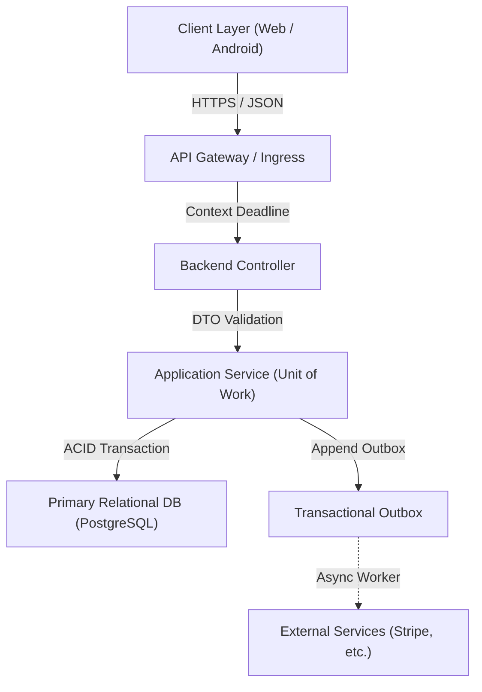
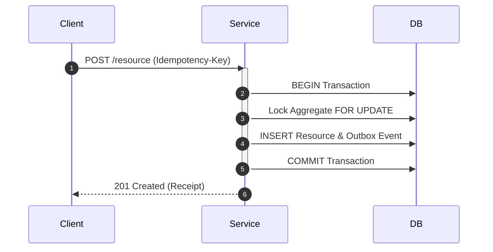

# Technical Design Document: [Feature / System Name]

> **Document Status**: Draft / In Review / Approved  
> **Author**: [Lead Engineer / Architect]  
> **Date**: [YYYY-MM-DD]  
> **Reference Specs**: [Link to Requirements Spec]  

---

## 1. Context & Architectural Overview

*Describe the technical motivation, background, and high-level architectural approach. Explain how this design fits into existing system boundaries.*

### 1.1 Architecture Fit & Trade-Offs
* **Chosen Pattern**: [e.g. Clean Architecture + MVVM / Layered REST API / Event-Driven Outbox]
* **Why Chosen Over Simpler Alternatives**: [Explain why a simpler direct call or 2-tier design was insufficient]
* **Identified Trade-offs**: [Memory footprint, latency overhead, cognitive complexity]

---

## 2. System Architecture & Component Diagrams

### 2.1 C4 Container Diagram


### 2.2 Sequence Flow: Core Transaction


---

## 3. Data Storage & Schema Design

### 3.1 Primary Entities & Tables
*Describe the tables, primary keys, indexing strategies, and declarative constraints.*

```sql
-- Schema snippet for core entity
CREATE TABLE example_entities (
    id UUID PRIMARY KEY DEFAULT gen_random_uuid(),
    tenant_id UUID NOT NULL,
    status TEXT NOT NULL,
    version INT NOT NULL DEFAULT 1,
    created_at TIMESTAMPTZ NOT NULL DEFAULT CURRENT_TIMESTAMP,

    CONSTRAINT chk_status_valid CHECK (status IN ('PENDING', 'ACTIVE', 'ARCHIVED'))
);

CREATE INDEX idx_example_lookup ON example_entities (tenant_id, status, created_at DESC);
```

---

## 4. API & Interface Contracts

### 4.1 Endpoint Specification
* **Route**: `POST /api/v1/[resources]`
* **Headers**:
  * `Authorization`: `Bearer <jwt_token>`
  * `Idempotency-Key`: `<uuidv7>`
  * `X-Request-Deadline`: `<iso8601_utc>`
* **Success Response (201 Created)**:
  ```json
  {
    "id": "123e4567-e89b-12d3-a456-426614174000",
    "status": "ACTIVE",
    "createdAt": "2026-11-03T14:30:00.000Z"
  }
  ```
* **Error Response (RFC 9457 Problem Details)**:
  ```json
  {
    "type": "https://api.example.com/errors/conflict",
    "title": "Conflict",
    "status": 409,
    "detail": "Resource with this identifier already exists.",
    "instance": "/api/v1/resources"
  }
  ```

---

## 5. Security & Threat Modeling (STRIDE)

| Threat Category | Potential Vulnerability | Mitigation Strategy |
| :--- | :--- | :--- |
| **Spoofing** | Forged JWT access token | Stateless signature verification via cached JWKS public keys |
| **Tampering** | Parameter manipulation in mutation | SHA-256 payload hash verification on idempotency key replay |
| **Repudiation** | Denying an order was placed | Append-only tamper-evident `audit_ledger` record committed in transaction |
| **Information Leak**| Database error returned to user | Catch SQLSTATE; map to RFC 9457 without schema leakage |
| **Denial of Service**| Connection pool starvation | Strict `statement_timeout` (2s) and rate limiting (100 req/min) |
| **Elevation of Priv**| Cross-tenant IDOR / BOLA | Service layer verifies `subject_id` owns target `resource_id` |

---

## 6. Migration, Rollout & Rollback Strategy

1. **Phase 1 (Expand)**: Deploy non-breaking schema additions (nullable columns, `NOT VALID` constraints).
2. **Phase 2 (Dual-Run / Backfill)**: Application version N+1 reads and writes new format; backfill historical rows.
3. **Phase 3 (Contract)**: Validate check constraints, apply `NOT NULL`, drop legacy columns.
4. **Rollback Plan**: Document exact steps to revert application version and database schema safely.
