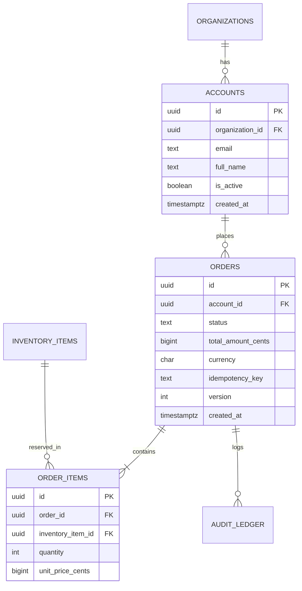

# Database Design Specification: [System / Domain Name]

> **Database Engine**: PostgreSQL 16+ / SQLite (Room)  
> **Status**: Draft / In Review / Approved  
> **Author**: [Lead Engineer / Database Architect]  
> **Date**: [YYYY-MM-DD]  

---

## 1. Data Model Overview & Normalization Strategy

*Explain the domain data model. All operational relational schemas must adhere to Third Normal Form (3NF) to eliminate update anomalies and duplicate state.*

### 1.1 Entity-Relationship Diagram (ERD)


---

## 2. Table Schemas, Constraints & Invariants

```sql
-- 1. Accounts Table
CREATE TABLE accounts (
    id UUID PRIMARY KEY DEFAULT gen_random_uuid(),
    organization_id UUID NOT NULL,
    email TEXT NOT NULL,
    full_name TEXT NOT NULL,
    is_active BOOLEAN NOT NULL DEFAULT TRUE,
    created_at TIMESTAMPTZ NOT NULL DEFAULT CURRENT_TIMESTAMP,
    updated_at TIMESTAMPTZ NOT NULL DEFAULT CURRENT_TIMESTAMP,

    CONSTRAINT uq_accounts_org_email UNIQUE (organization_id, email),
    CONSTRAINT chk_accounts_email_format CHECK (email ~* '^[A-Za-z0-9._%+-]+@[A-Za-z0-9.-]+\.[A-Za-z]{2,}$'),
    CONSTRAINT chk_accounts_name_non_empty CHECK (length(trim(full_name)) > 0)
);

-- Partial index for active account lookup (zero bloat for deactivated rows)
CREATE INDEX idx_accounts_active_email ON accounts (organization_id, email)
WHERE is_active = TRUE;

-- 2. Orders Table (Transactional Aggregate)
CREATE TABLE orders (
    id UUID PRIMARY KEY DEFAULT gen_random_uuid(),
    account_id UUID NOT NULL,
    organization_id UUID NOT NULL,
    status TEXT NOT NULL DEFAULT 'PENDING',
    total_amount_cents BIGINT NOT NULL,
    currency CHAR(3) NOT NULL DEFAULT 'USD',
    idempotency_key TEXT NOT NULL,
    idempotency_payload_hash CHAR(64) NOT NULL,
    metadata JSONB NOT NULL DEFAULT '{}'::jsonb,
    version INT NOT NULL DEFAULT 1, -- Optimistic Concurrency Control (OCC)
    created_at TIMESTAMPTZ NOT NULL DEFAULT CURRENT_TIMESTAMP,
    updated_at TIMESTAMPTZ NOT NULL DEFAULT CURRENT_TIMESTAMP,

    CONSTRAINT fk_orders_account FOREIGN KEY (account_id) REFERENCES accounts (id) ON DELETE RESTRICT,
    CONSTRAINT chk_orders_status CHECK (status IN ('PENDING', 'CONFIRMED', 'CANCELLED')),
    CONSTRAINT chk_orders_amount_positive CHECK (total_amount_cents >= 0),
    CONSTRAINT chk_orders_currency CHECK (currency ~ '^[A-Z]{3}$'),
    CONSTRAINT uq_orders_org_idempotency UNIQUE (organization_id, idempotency_key)
);

-- Composite B-Tree Index following Left-to-Right prefix rule
CREATE INDEX idx_orders_org_status_created ON orders (
    organization_id,
    status,
    created_at DESC
) INCLUDE (total_amount_cents);
```

---

## 3. Migration Plan (Expand-and-Contract Discipline)

| Phase | DDL / DML Operation | Lock Timeout | Application Compatibility |
| :---: | :--- | :---: | :--- |
| **Phase 1 (Expand)** | `ALTER TABLE ... ADD COLUMN ...` as nullable.<br />`ADD CONSTRAINT ... NOT VALID;` | `2s` | Version N and N+1 both function normally. |
| **Phase 2 (Validate)**| `ALTER TABLE ... VALIDATE CONSTRAINT ...;`<br />`CREATE INDEX CONCURRENTLY ...;` | None (weak lock) | Backfill historical records in throttled batches. |
| **Phase 3 (Contract)**| Set default; enforce `NOT NULL` via validated check; drop deprecated columns. | `2s` | Executed only after Version N+1 is 100% deployed. |

---

## 4. Operational Invariants & Security Boundaries

1. **Role Separation**:
   * `migration_runner`: Full DDL permissions (used strictly during CI/CD migrations).
   * `app_user`: DML permissions (`SELECT`, `INSERT`, `UPDATE`, `DELETE`) only.
   * `readonly_analyst`: `SELECT` permissions only.
2. **Session Defaults**:
   * `SET lock_timeout = '2s';`
   * `SET statement_timeout = '2s';`
   * Timezone: UTC strictly enforced.
